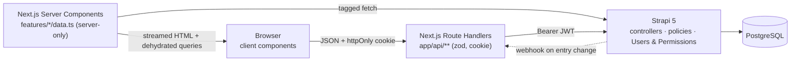
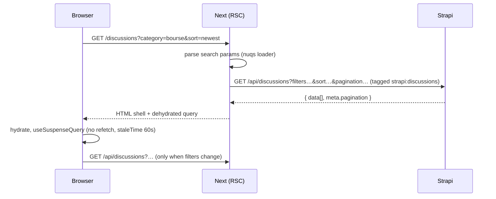
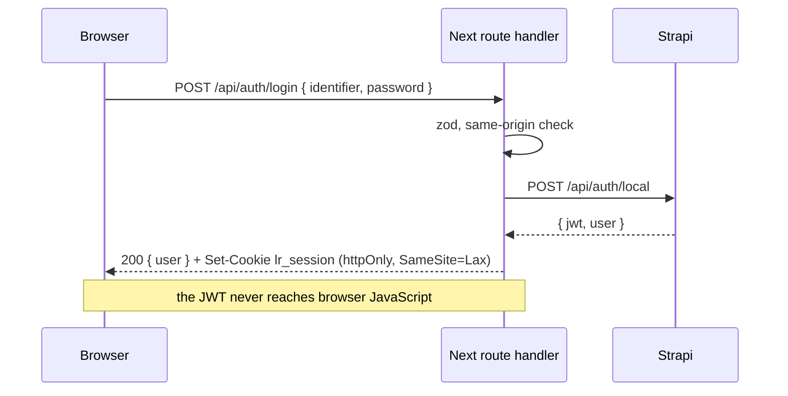
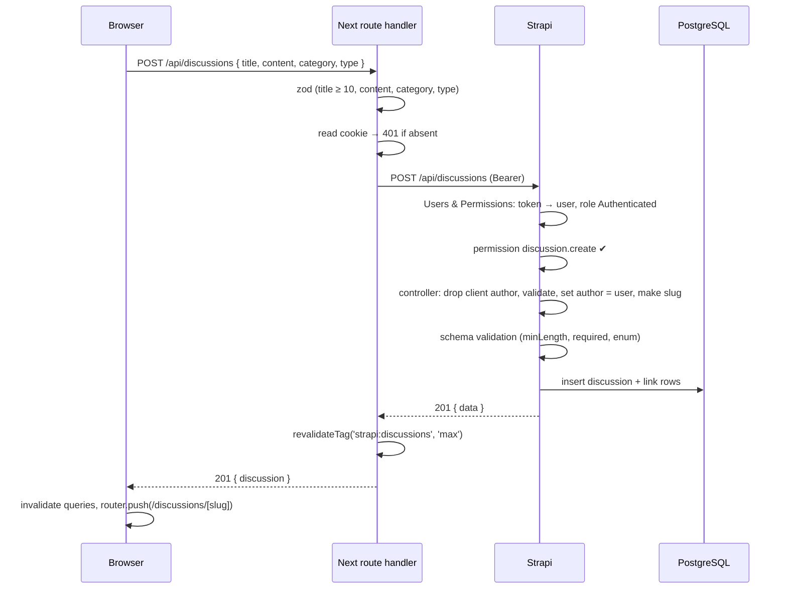
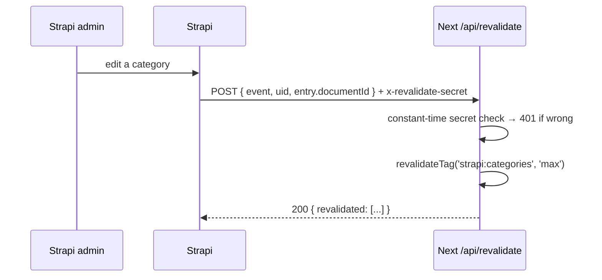

# Architecture

Next.js renders and serves the site. Strapi owns data, validation and permissions. PostgreSQL stores it. The browser never learns the Strapi URL.

## System

Rules:

1. Server Components read through the data access layer and never call the app's own Route Handlers.
2. Client Components only call `/api/*`.
3. Route Handlers validate input with zod, forward the JWT, map errors, never return the JWT.
4. Strapi is the single source of truth for data rules (ADR-0001, ADR-0002).

## Read a list page

## Log in

## Create a discussion

Failure paths: no token → 403 from Strapi (Public lacks `create`); short title → 400 `ValidationError` mapped to 422 with field errors; client-supplied `author` → ignored.

## Keep cached pages honest

Lists are never cached; categories and discussion detail reads are cached with tags (ADR-0003, ADR-0006).

## Localisation

French is the default locale and keeps clean URLs (`/discussions`); other locales are prefixed (`/en/discussions`). UI strings, metadata and dates are localised in Next. Only categories are localised in Strapi; the data access layer passes the current locale and falls back to French.
