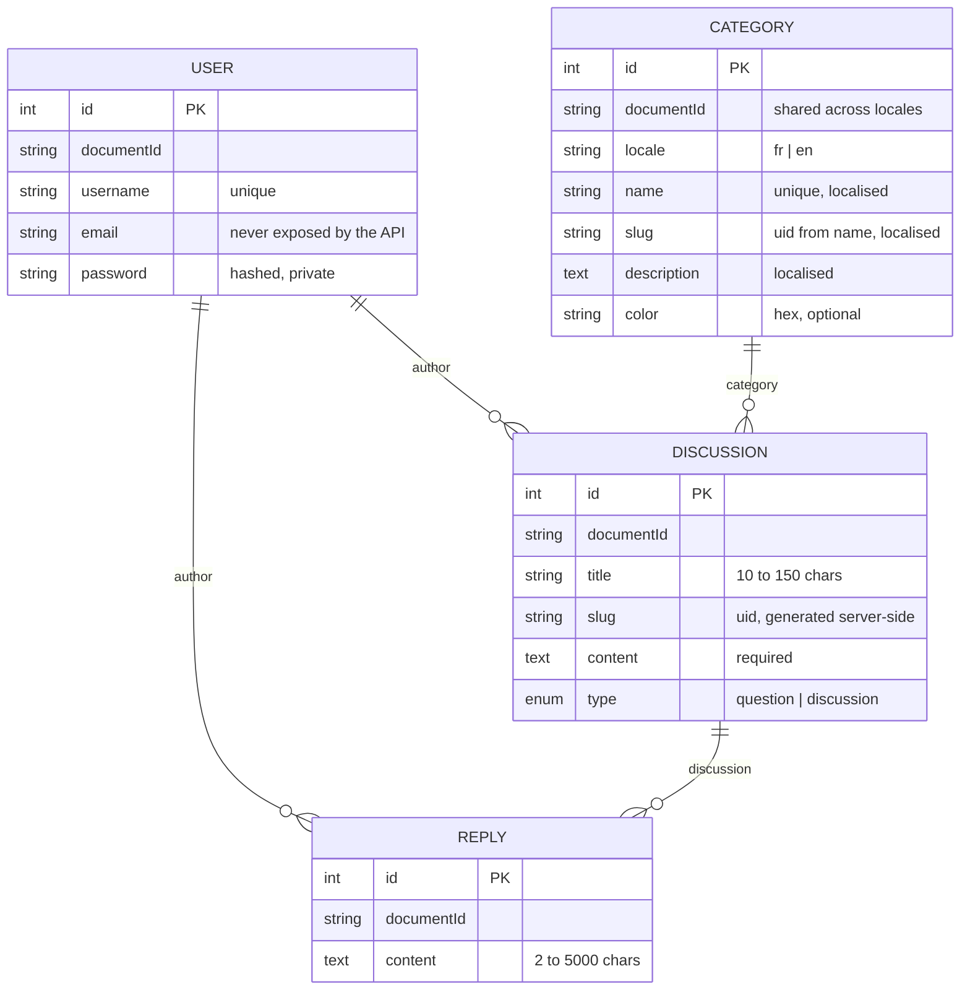

# Data model

Four entities. `User` comes from Strapi's Users & Permissions plugin and is left untouched. The three others are our content types.

## Entity relationship diagram

Every entity also carries `createdAt`, `updatedAt` and `publishedAt`, managed by Strapi.

## Relations

| Field                 | Target     | Cardinality | Strapi definition                                         |
| --------------------- | ---------- | ----------- | --------------------------------------------------------- |
| `Discussion.author`   | User       | many → one  | `manyToOne`, no inverse on User                           |
| `Reply.author`        | User       | many → one  | `manyToOne`, no inverse on User                           |
| `Discussion.category` | Category   | many → one  | `manyToOne`, inverse `Category.discussions` (`oneToMany`) |
| `Reply.discussion`    | Discussion | many → one  | `manyToOne`, inverse `Discussion.replies` (`oneToMany`)   |

`User` gets no inverse fields on purpose: a user's posts are a query, and adding fields to the user widens what the Users & Permissions API can expose.

## Storage

Strapi 5 keeps no foreign key on the entity table. Each relation becomes a link table:

| Link table                 | Columns                                          |
| -------------------------- | ------------------------------------------------ |
| `discussions_author_lnk`   | `discussion_id`, `user_id`                       |
| `discussions_category_lnk` | `discussion_id`, `category_id`, `discussion_ord` |
| `replies_author_lnk`       | `reply_id`, `user_id`                            |
| `replies_discussion_lnk`   | `reply_id`, `discussion_id`, `reply_ord`         |

This shape belongs to Strapi and changes when a content type changes, which is why the frontend never reads the database directly (ADR-0001, ADR-0005).

## Constraints and where they are enforced

| Rule                                 | Schema (`schema.json`)               | Controller                                                    | Policy                              |
| ------------------------------------ | ------------------------------------ | ------------------------------------------------------------- | ----------------------------------- |
| Title between 10 and 150 characters  | `minLength`, `maxLength`, `required` |                                                               |                                     |
| Content required                     | `required`                           |                                                               |                                     |
| Type is `question` or `discussion`   | `enumeration`, default `discussion`  |                                                               |                                     |
| Category required                    | `required` on the relation           |                                                               |                                     |
| Author is always the logged-in user  |                                      | `create` strips any client `author`, sets `ctx.state.user.id` |                                     |
| Author cannot be changed             |                                      | `update` strips `author`                                      |                                     |
| Only the owner edits or deletes      |                                      |                                                               | `is-owner` on `update` and `delete` |
| Slug is unique and server-made       | `uid`                                | `create` generates it from the title                          |                                     |
| Reply targets an existing discussion |                                      | `create` checks, else 404                                     |                                     |
| Draft & Publish                      | **off** on all three types           |                                                               |                                     |

Draft & Publish is off because Strapi skips `required` and `minLength` on drafts and hides unpublished entries from the API by default.

## Permissions

| Action                                     | Public | Authenticated                     |
| ------------------------------------------ | ------ | --------------------------------- |
| `category.find`, `category.findOne`        | ✔      | ✔                                 |
| `discussion.find`, `findOne`, `findBySlug` | ✔      | ✔                                 |
| `reply.find`, `reply.findOne`              | ✔      | ✔                                 |
| `discussion.create`, `update`, `delete`    |        | ✔ (+ `is-owner` on update/delete) |
| `reply.create`, `update`, `delete`         |        | ✔ (+ `is-owner` on update/delete) |
| `user.find`                                | never  | never                             |

A write without a token answers **403** (the Public role exists but lacks `create`); a write with an invalid token answers **401**. Sign-up is disabled.

## Localisation

| Type       | Localised                                               | Why                                                    |
| ---------- | ------------------------------------------------------- | ------------------------------------------------------ |
| Category   | yes: `name`, `description`, `slug` (`fr` default, `en`) | A space is a product concept with a label per language |
| Discussion | no                                                      | Written by a reader in one language                    |
| Reply      | no                                                      | Same                                                   |
| User       | no                                                      |                                                        |

A non-localised discussion points at a category document; the frontend asks Strapi for the category in the current locale and falls back to French when a translation is missing. Adding a language means adding a locale in Strapi and translating the categories; the model does not change.

## Output shapes the frontend relies on

The controllers force the populate so every response has a stable, minimal shape:

- List item: `documentId, title, slug, type, createdAt, author { documentId, username }, category { documentId, name, slug, color }, replies { count }`
- Detail: the same plus `content` and `replies[] { documentId, content, createdAt, author { documentId, username } }`

`email` is never populated and numeric `id`s are stripped: only `documentId` (24 random characters) identifies anything outside the server. A test asserts both.
