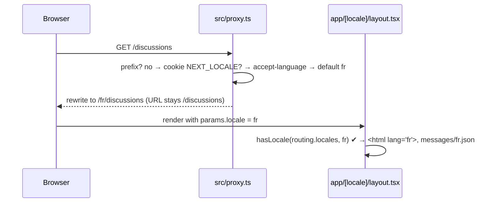

# 01 — i18n foundation

Branch: `feature/i18n-foundation` · Target: `development` · Estimate: 6 h · Status: done

## 1. Goal

After this branch, the site serves French by default and English under `/en`, with every UI string, date and page title coming from locale files, and Strapi able to hold a French and an English version of each category. Adding a third language later means adding a locale file and translating categories, nothing structural. The branch also removes scaffold leftovers so the repository only contains what the product needs.

Brief lines served: "Interface responsive et respect global de la maquette" (the mockup is French-first), and the general expectation of a maintainable, scalable structure. The brief does not require English; this is a product decision taken on day one because retrofitting it is expensive.

## 2. Scope

**In**

- next-intl wired into the web app: routing, request config, navigation helpers, proxy, `[locale]` root layout, typed messages.
- `messages/fr.json` and `messages/en.json` with the namespaces every later feature will fill.
- Locale-aware dates and relative times through next-intl formatters.
- Per-locale metadata: `<html lang>`, `generateMetadata` with hreflang alternates, `sitemap.ts`, `robots.ts`.
- Language switcher in the header.
- Strapi: French as the default locale, English enabled, Category marked localisable (schema written in branch 02, locale setup here).
- Scaffold cleanup: both `AGENTS.md`, the five Next demo SVGs, the two Strapi example files, the two default app READMEs.
- `CONTRIBUTING.md`: only features get a branch.
- Patch bump of `next` to 16.4.3.

**Out**

- Translating user content (discussions, replies). They stay in the language the reader wrote.
- Translated category slugs. v1 keeps identical slugs in both locales so alternate links stay 1:1. Noted as an evolution.
- Any forum page. Those come with their own branches; this one ships the home redirect and a placeholder `/discussions` page proving the locale machinery end to end.

## 3. Acceptance criteria

1. `/` renders French with `<html lang="fr">`; `/en` renders English with `<html lang="en">`.
2. `/fr/discussions` redirects to `/discussions`; `/en/discussions` serves English; `/de/discussions` returns 404.
3. The header language switcher keeps the current path and only changes the locale prefix.
4. Every visible string on the placeholder pages comes from `messages/*.json`; a missing key fails the type-check.
5. `generateMetadata` emits a localized title and description plus `alternates.languages` for `fr`, `en` and `x-default`.
6. `sitemap.xml` lists each URL once with hreflang alternates; `robots.txt` points at it.
7. Dates render as `25 oct. 2026` in French and `Oct 25, 2026` in English from the same ISO string; relative times update on the client without hydration warnings.
8. Strapi boots with `fr` as default locale and `en` present; a category can be created in `fr` and given an `en` version through the Document Service, both sharing one `documentId`.
9. `pnpm verify` is green from a clean clone.

## 4. Mockups

### Header with the language switcher (desktop, French)

```
┌────────────────────────────────────────────────────────────────────┐
│ LE REVENU · Communauté        [Rechercher…]        FR | EN   Se connecter │
└────────────────────────────────────────────────────────────────────┘
```

### Same header, English, same page

```
┌────────────────────────────────────────────────────────────────────┐
│ LE REVENU · Community         [Search…]            FR | EN   Sign in      │
└────────────────────────────────────────────────────────────────────┘
URL: /en/discussions?category=bourse&sort=newest   (search params untouched)
```

### Mobile header (≤ 760 px)

```
┌──────────────────────────────┐
│ LE REVENU    FR|EN   ☰       │
└──────────────────────────────┘
```

### URL matrix

| Reader wants                 | URL                                          | Why                                   |
| ---------------------------- | -------------------------------------------- | ------------------------------------- |
| French list                  | `/discussions`                               | Default locale, no prefix             |
| English list                 | `/en/discussions`                            | Prefixed                              |
| Typed `/fr/discussions`      | 307 → `/discussions`                         | Prefix is superfluous for the default |
| Typed `/de/discussions`      | 404                                          | Not a configured locale               |
| Strapi categories in English | `GET /api/categories?locale=en`              | Strapi i18n                           |
| Strapi categories in French  | `GET /api/categories?locale=fr` (or omitted) | Default locale                        |

### Locale negotiation (sequence)



### Category in two locales (Strapi)

```
documentId k7q…   locale fr   name "Bourse & actions"   slug "bourse"
documentId k7q…   locale en   name "Stocks & markets"   slug "bourse"
```

## 5. Design

**Library.** next-intl 4.14.9. Rationale: the only maintained option with first-class Next 16 support; since Next 16.3 root params it no longer reads request headers, so it works inside `'use cache'` and keeps pages statically prerenderable. Alternatives considered: Lingui (more plumbing), Paraglide (needs webpack, we are on Turbopack), next-international (unmaintained since 2024). ADR-0007 records this.

**Routing.** `localePrefix: 'as-needed'`, `defaultLocale: 'fr'`, `locales: ['fr', 'en']` in `src/i18n/routing.ts`. `localeDetection` stays on; `alternateLinks` stays on because slugs are identical across locales in v1.

**Files (web).**

```
messages/fr.json  messages/en.json            # repo root of apps/web, FR is the typed source
src/i18n/routing.ts                           # defineRouting
src/i18n/navigation.ts                        # Link, redirect, usePathname, useRouter, getPathname
src/i18n/request.ts                           # getRequestConfig reading next/root-params, timeZone Europe/Paris, formats
src/proxy.ts                                  # createMiddleware(routing) composed with the optimistic cookie check
src/app/[locale]/layout.tsx                   # the only root layout: generateStaticParams, hasLocale, <html lang>, NextIntlClientProvider
src/app/[locale]/page.tsx                     # redirect to /discussions
src/app/[locale]/(forum)/discussions/page.tsx # placeholder proving translations, dates, metadata
src/app/global-not-found.tsx                  # global 404 (required with a [locale] root layout under Cache Components)
src/app/sitemap.ts  src/app/robots.ts
src/components/layout/locale-switcher.tsx     # client component, uses usePathname + useRouter from navigation
src/lib/date.ts                               # thin wrappers over getFormatter / useFormatter
global.d.ts                                   # AppConfig augmentation: Locale union, Messages type, Formats
```

Message namespaces: `Common`, `Nav`, `Metadata`, `Discussions`, `DiscussionNew`, `Replies`, `Categories`, `Sort`, `Errors`, `Auth`. Keys are stable English identifiers; values are the translations. French plural rule: `one` covers 0 and 1, so `{count, plural, =0 {Aucune réponse} one {# réponse} other {# réponses}}`.

**No deprecated APIs.** No `setRequestLocale`, no `requestLocale`; `request.ts` reads the locale from `next/root-params`. `generateStaticParams` on the `[locale]` layout is mandatory with Cache Components.

**Relative time.** Rendered by a small client component using `useNow({ updateInterval: 60_000 })` and `format.relativeTime`, never inside a cached scope, to avoid hydration mismatch.

**Search params.** nuqs values stay English keys (`sort=newest`); only labels are translated. No change to the nuqs design.

**Strapi.** `STRAPI_PLUGIN_I18N_INIT_LOCALE_CODE=fr` in `.env.example` and `.env` before first boot (only honoured when no locale exists yet). Bootstrap ensures `en` through `strapi.plugin('i18n').service('locales')` (`findByCode`, `create`). Category schema (branch 02) gets `pluginOptions.i18n.localized: true`; `uid` and relation fields are per-locale by design. Seed pattern: `documents.create({ locale: 'fr' })` then `documents.update({ documentId, locale: 'en', data })`. `locale=all` does not exist in Strapi 5, so the DAL fetches the requested locale and merges a French fallback by `documentId`.

**Relation subtlety.** A discussion's `category` relation points at the French row by default. The frontend resolves the label by `documentId` through the locale's category map, never by trusting the populated row's language. Written into `docs/data-model.md`.

**Proxy.** `src/proxy.ts` strips the locale prefix, redirects `/discussions/new` to the localized login when the session cookie is absent, then delegates to the next-intl middleware. Node runtime, default matcher.

**Extensibility.** Adding `es`: add it to `routing.locales`, add `messages/es.json`, add the Strapi locale, run the category translation seed, add a Playwright project. Everything else iterates `routing.locales`.

## 6. Phases and steps

### Phase A — Cleanup and rules (30 min)

1. Delete `AGENTS.md`, `apps/web/AGENTS.md`, `apps/web/public/*.svg`, `apps/cms/src/admin/app.example.tsx`, `apps/cms/src/admin/vite.config.example.ts`.
2. Replace `apps/web/README.md` and `apps/cms/README.md` with five-line READMEs pointing at the root.
3. `CONTRIBUTING.md`: add "Only features get a branch; smaller work rides in the next feature branch or is agreed first."
4. Bump `next` and `eslint-config-next` to 16.4.3.

Exit: `pnpm verify` green.

### Phase B — Strapi locales (45 min)

5. `STRAPI_PLUGIN_I18N_INIT_LOCALE_CODE=fr` in `apps/cms/.env.example` and `.env`.
6. `src/index.ts` `bootstrap`: `ensureLocales(['en'])` helper, idempotent, logged.
7. First real boot against Postgres: `pnpm --filter cms develop`, create the admin user, confirm Settings → Internationalization shows `fr` default and `en`.
8. Env guard in `register()` for required variables (planned rule from §7.1 of the master plan): fail fast on missing or `change-me`.

Exit: Strapi boots, two locales present, env guard proven by one deliberate failure.

### Phase C — next-intl wiring (2 h)

9. Install `next-intl`; add the plugin in `next.config.ts` with `createMessagesDeclaration`.
10. `src/i18n/routing.ts`, `navigation.ts`, `request.ts`; `global.d.ts` augmentation.
11. Move the root layout to `src/app/[locale]/layout.tsx` with `generateStaticParams`, `hasLocale` + `notFound`, fonts, `<html lang>`, `NextIntlClientProvider`; add `global-not-found.tsx`.
12. `src/proxy.ts` composing the cookie check and the intl middleware.
13. `messages/fr.json`, `messages/en.json` with all namespaces and the strings for the header, placeholder page, errors and metadata.
14. `src/app/[locale]/page.tsx` redirect; placeholder `discussions/page.tsx` rendering a translated title, one formatted date, one relative time component and one plural.
15. `LocaleSwitcher` in `SiteHeader` (header shell only; full header styling arrives with the list branch).

Exit: criteria 1 to 4 and 7 pass manually.

### Phase D — Metadata and SEO (45 min)

16. `generateMetadata` on the layout and placeholder page with `alternates.languages` built from `getPathname` over `routing.locales`; `metadataBase` from `NEXT_PUBLIC_APP_URL`.
17. `sitemap.ts` (static routes for now, discussions added in branch 03) and `robots.ts`.

Exit: criteria 5 and 6 pass.

### Phase E — Tests and CI (1 h)

18. `vitest.config.mts` for web (happy-dom, `vite-tsconfig-paths`, `server.deps.inline: ['next-intl']`), `src/test/setup.ts`, `renderWithIntl` helper.
19. Unit tests: `locale-switcher.test.tsx`, `relative-time.test.tsx`, `messages.test.ts` (both files have identical key sets).
20. `playwright.config.ts` with `fr` and `en` projects; `e2e/i18n.spec.ts` for criteria 1, 2, 3, 5.
21. CI: `test-unit` job added to `ci.yml`.

Exit: `pnpm verify` green, PR opened.

## 7. Tests

| Kind              | File                                                                                      | Covers criterion |
| ----------------- | ----------------------------------------------------------------------------------------- | ---------------- |
| unit              | `src/components/layout/locale-switcher.test.tsx`                                          | 3                |
| unit              | `src/components/shared/relative-time.test.tsx`                                            | 7                |
| unit              | `messages/messages.test.ts` (key parity fr ↔ en)                                          | 4                |
| e2e               | `e2e/i18n.spec.ts`                                                                        | 1, 2, 3, 5, 6    |
| integration (cms) | `tests/locales.test.ts` (fr default, en present, create + update category across locales) | 8                |
| ci                | `pnpm verify`                                                                             | 9                |

## 8. Manual verification

- [ ] `/`, `/en`, `/fr/discussions`, `/de/discussions` behave per the URL matrix
- [ ] Switcher keeps `?category=&sort=` intact
- [ ] View source: `<html lang>`, `<link rel="alternate" hreflang>`, localized `<title>`
- [ ] Dark mode and 400 px width on the placeholder page
- [ ] No console errors, no hydration warnings on the relative time
- [ ] Strapi admin shows both locales; `GET /api/categories?locale=en` returns the English row once branch 02 seeds exist

## 9. Risks and open questions

| Risk or question                                                                                        | Mitigation or decision                                                                                                |
| ------------------------------------------------------------------------------------------------------- | --------------------------------------------------------------------------------------------------------------------- |
| `Link` from `createNavigation` inside a `'use cache'` scope once read headers (next-intl #2229, closed) | Verify on 4.14.9 in Phase C; fallback: pass links as `children` into cached components                                |
| `/` may redirect a returning English reader to `/en` because of the `NEXT_LOCALE` cookie                | Accepted; it is the expected behaviour. Switch `localeDetection: false` if SEO prefers a deterministic `/`            |
| `alternateLinks` from the proxy become wrong if slugs are ever translated                               | Keep identical slugs in v1; if translated later, disable `alternateLinks` and emit alternates from `generateMetadata` |
| `generateStaticParams` is mandatory with Cache Components; forgetting it fails the build                | Step 11 includes it; `pnpm verify` catches it                                                                         |
| Strapi `STRAPI_PLUGIN_I18N_INIT_LOCALE_CODE` is ignored once a locale exists                            | Set before the first boot; bootstrap `setDefaultLocale` as a safety net                                               |

## 10. Definition of done

- [x] All acceptance criteria met (8 verified manually, see tests table)
- [x] Tests in section 7 green locally; CI unit job added
- [x] Manual checklist done by the author (URL matrix, switcher, view source, console); dark mode and 400 px width to be confirmed in PR review
- [x] `docs/adr/0007-i18n-next-intl.md` written; `docs/data-model.md` localisation section confirmed; this plan's status set to done
- [ ] PR opened against `development` with screenshots of FR and EN headers
