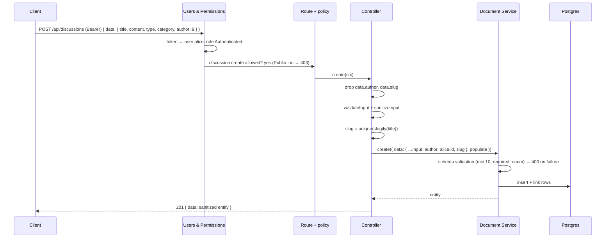
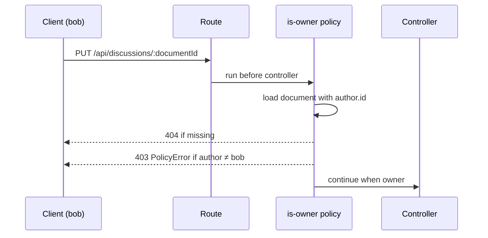

# 02 — Strapi content types, permissions, seed and tests

Branch: `feature/cms-content-types` · Target: `development` · Estimate: 8 h · Status: draft

## 1. Goal

After this branch, Strapi exposes the whole forum API the brief asks for, enforces every rule itself, and ships with demo data. A reader can list, filter, sort and paginate discussions, read one with its replies, log in as a demo user, create a discussion and reply. Nobody can post without a token, post as someone else, bypass the 10-character title rule, or edit another member's post. Seven automated tests prove it against PostgreSQL.

Brief lines served: section 2.A to 2.D (features), section 3 (backend architecture), section 6 (tests), and the deliverables "configuration PostgreSQL et schémas", "mécanisme d'initialisation des données", "tests automatisés".

## 2. Scope

**In**

- Content types `Category` (localised fr/en), `Discussion`, `Reply`, Draft & Publish off.
- Permissions for Public and Authenticated, set in code at boot. Sign-up disabled.
- Controllers: forced author, server-made slug, forced populate, reply count, lookup by slug.
- `is-owner` policy on update and delete.
- Demo data: 3 users, 11 categories in two languages, 12 discussions, ~25 replies.
- Test harness (Vitest + supertest, Strapi in-process on `lerevenu_test`) and the seven tests.
- CI job `test-cms` with a Postgres service container.
- `.env.ci` for CI, `database/migrations` index on `discussions.created_at`.

**Out**

- Votes, best answer, search beyond title filter, user profile (bonus, later or never).
- Webhook registration in bootstrap (branch 04 with the Next revalidate handler).
- Anything in `apps/web`.

## 3. Acceptance criteria

1. `GET /api/discussions` returns paginated items with `title, slug, type, createdAt, author.username, category.{name,slug,color}, replies.count`, never `author.email`.
2. `?filters[category][slug][$eq]=bourse`, `?sort=createdAt:asc|desc`, `?pagination[page]=2&pagination[pageSize]=5` work; `pageSize` is capped at 50.
3. `GET /api/discussions/slug/:slug` returns the discussion with `content` and ordered replies, 404 for an unknown slug.
4. `POST /api/discussions` without a token answers 403; with an invalid token 401.
5. `POST /api/discussions` with a title under 10 characters answers 400 `ValidationError` naming `title`.
6. `POST /api/discussions` with `data.author` set to another user answers 201 and the stored author is the caller.
7. `POST /api/replies` has the same three behaviours and answers 404 for an unknown discussion.
8. `PUT`/`DELETE` on another member's discussion or reply answers 403; on your own, 200/204.
9. `POST /api/auth/local` with a demo account answers `{ jwt, user }`; `POST /api/auth/local/register` answers 400 (sign-ups disabled).
10. `GET /api/categories?locale=en` returns English names; without `locale`, French.
11. A fresh database boots with the demo data; a second boot does not duplicate it.
12. The seven brief tests pass locally and in CI; `pnpm verify` is green.

## 4. Mockups

### Entities

See `docs/data-model.md` for the diagram. Field-level constraints:

| Type       | Field       | Type         | Rules                                            |
| ---------- | ----------- | ------------ | ------------------------------------------------ |
| Category   | name        | string       | required, unique, max 80, localised              |
|            | slug        | uid ← name   | required, per locale (identical in v1)           |
|            | description | text         | required, max 300, localised                     |
|            | color       | string       | optional, `#rrggbb`                              |
| Discussion | title       | string       | required, min 10, max 150                        |
|            | slug        | uid ← title  | required, server-made                            |
|            | content     | text         | required, max 20 000                             |
|            | type        | enum         | `question` \| `discussion`, default `discussion` |
|            | author      | → user       | forced from session                              |
|            | category    | → category   | required                                         |
|            | replies     | ← reply      |                                                  |
| Reply      | content     | text         | required, min 2, max 5 000                       |
|            | author      | → user       | forced from session                              |
|            | discussion  | → discussion | required, must exist                             |

### API contract

| Method · path                                     | Auth           | Body                                               | Answers                           |
| ------------------------------------------------- | -------------- | -------------------------------------------------- | --------------------------------- |
| `GET /api/categories?locale=fr\|en`               | public         | —                                                  | 200 list                          |
| `GET /api/discussions?filters…&sort…&pagination…` | public         | —                                                  | 200 `{ data[], meta.pagination }` |
| `GET /api/discussions/slug/:slug`                 | public         | —                                                  | 200 · 404                         |
| `POST /api/discussions`                           | Bearer         | `{ data: { title, content, type, category } }`     | 201 · 400 · 403                   |
| `PUT /api/discussions/:documentId`                | Bearer + owner | `{ data: { title?, content?, type?, category? } }` | 200 · 400 · 403 · 404             |
| `DELETE /api/discussions/:documentId`             | Bearer + owner | —                                                  | 204 · 403 · 404                   |
| `POST /api/replies`                               | Bearer         | `{ data: { content, discussion } }`                | 201 · 400 · 403 · 404             |
| `PUT` / `DELETE /api/replies/:documentId`         | Bearer + owner |                                                    | 200/204 · 403 · 404               |
| `POST /api/auth/local`                            | —              | `{ identifier, password }`                         | 200 `{ jwt, user }` · 400         |
| `GET /api/users/me`                               | Bearer         | —                                                  | 200 user · 401                    |

List item example:

```json
{
  "id": 7,
  "documentId": "k7q2m9x1c0d3e4f5g6h7i8j9",
  "title": "Faut-il ouvrir un PER à 45 ans ?",
  "slug": "faut-il-ouvrir-un-per-a-45-ans",
  "type": "question",
  "createdAt": "2026-10-20T08:12:00.000Z",
  "author": { "id": 3, "documentId": "…", "username": "alice" },
  "category": {
    "id": 2,
    "documentId": "…",
    "name": "Retraite",
    "slug": "retraite",
    "color": "#ff2d55"
  },
  "replies": { "count": 3 }
}
```

Error example (title too short):

```json
{
  "data": null,
  "error": {
    "status": 400,
    "name": "ValidationError",
    "message": "title must be at least 10 characters",
    "details": {
      "errors": [
        {
          "path": ["title"],
          "message": "title must be at least 10 characters",
          "name": "ValidationError"
        }
      ]
    }
  }
}
```

### Create a discussion (sequence)



### Owner check on update (sequence)



## 5. Design

**Schemas** live in `src/api/<type>/content-types/<type>/schema.json`, with `"options": { "draftAndPublish": false }`. Category adds `"pluginOptions": { "i18n": { "localized": true } }` at the root and on `name` and `description`. Relations: `author` is `manyToOne` to `plugin::users-permissions.user` with no inverse; `category` is `manyToOne` with inverse `discussions`; `discussion` on Reply is `manyToOne` with inverse `replies`.

**Why D&P is off:** Strapi skips `required` and `minLength` on drafts and hides unpublished entries by default. Written in ADR-0008.

**Controllers** (`createCoreController` overrides, each file under 120 lines):

- `discussion.find`: force `populate` to `{ author: { fields: ['username'] }, category: { fields: ['name','slug','color'] }, replies: { count: true } }`, default `sort = ['createdAt:desc']`. Client filters and pagination pass through after `validateQuery`.
- `discussion.findBySlug`: `findMany({ filters: { slug }, limit: 1 })` with replies populated (author username, `createdAt:asc`); 404 when empty.
- `discussion.create`: strip `author` and `slug`, `validateInput`, `sanitizeInput`, generate the slug, `documents().create` with `author: ctx.state.user.id`, `sanitizeOutput`, 201.
- `discussion.update`: strip `author` and `slug`, otherwise core behaviour.
- `reply.create`: strip `author`, check the target discussion exists (404), create with forced author, 201.
- `reply.find`: force `populate.author.fields = ['username']`.

**Slug:** `src/api/discussion/services/slug.ts`: `slugify(title)` (lowercase, accents stripped, hyphens, max 80) and uniqueness by appending `-2`, `-3` when a collision exists. The content-manager UID service is not used: it is undocumented for API code and the fallback is 20 lines.

**Policy** `src/api/discussion/policies/is-owner.ts` and the same for reply, registered in `routes/<type>.ts` on `update` and `delete`. Throws `NotFoundError` or `PolicyError` from `@strapi/utils`.

**Custom route** `src/api/discussion/routes/01-slug.ts`: `GET /discussions/slug/:slug` → `discussion.findBySlug`. Prefixed `01-` so it loads before the core router.

**Permissions** in `src/bootstrap/ensure-permissions.ts`, idempotent: find role by `type`, create missing `plugin::users-permissions.permission` rows. Public: `category.find/findOne`, `discussion.find/findOne/findBySlug`, `reply.find/findOne`. Authenticated: same plus `discussion.create/update/delete`, `reply.create/update/delete`. Never `user.find`. Sign-up off through `strapi.store` `advanced.allow_register = false`.

**Seed** in `src/seed/` split by concern (`users.ts`, `categories.ts`, `discussions.ts`, `index.ts`), each under 150 lines; data from the mockup in `src/seed/data/*.ts`. Runs from `bootstrap()` when `SEED_DEMO_DATA=true` and `count(category) === 0`; also `pnpm --filter cms seed`. Users via the Users & Permissions user service (bcrypt applied by Strapi). Categories: `create({ locale: 'fr' })` then `update({ documentId, locale: 'en' })`. Discussions connect to the category by `documentId`; `createdAt` spread over 30 days so sorting is visible.

**Config:** `rest.defaultLimit 10`, `rest.maxLimit 50` already set. `config/env/test/database.ts` targets `lerevenu_test`. `.env.ci` committed with non-secret values for CI.

**Test harness** `tests/setup/strapi.ts`: `compileStrapi()` + `createStrapi(ctx).load()` once (Vitest `globalSetup` + a `singleFork` pool), `NODE_ENV=test`, `STRAPI_DISABLE_CRON=true`, seed on, supertest on `strapi.server.httpServer`, teardown closes the server and the DB. Fallback if the in-process harness fights Vitest: black-box tests with `fetch` against `strapi start`.

**Index:** `database/migrations/2026.10.25T00.00.00.discussions-created-at.ts` adding an index on `discussions(created_at)`.

## 6. Phases and steps

### Phase A — Schemas (1 h)

1. Untrack the generated `fr.d.json.ts` and ignore it (housekeeping carried by this branch).
2. Write the three `schema.json` files and the empty `controllers/routes/services` files Strapi expects.
3. Boot `strapi develop`; check the tables and the admin Content-Type Builder.
4. `pnpm strapi ts:generate-types`, commit the generated types.
   Exit: admin shows the three types; `pnpm type-check` green.

### Phase B — Permissions and seed (2 h)

5. `ensure-permissions.ts` + sign-up off, called from `bootstrap()`.
6. Seed data files from the mockup (11 categories fr/en, 12 discussions, replies, 3 users).
7. Seed modules and the `seed` script; boot twice to prove idempotence.
8. curl: list, filter, sort, pagination, `?locale=en` categories.
   Exit: criteria 1, 2, 10, 11 pass by hand.

### Phase C — Controllers, policy, routes (2.5 h)

9. Slug service with unit-style tests through the API.
10. `discussion` controller overrides + `01-slug` route.
11. `reply` controller overrides.
12. `is-owner` policies and router config.
13. curl pass for criteria 3 to 9, including the author-spoof attempt.
    Exit: every criterion passes by hand.

### Phase D — Tests (2 h)

14. Vitest config, global setup, helpers (`login(username)`, `api()`), `.env.ci`, test database config.
15. Tests: validation, unauthenticated, spoof, list shape and pagination, reply rules, owner policy, login smoke.
16. `test-cms` CI job with a Postgres service container.
    Exit: `pnpm --filter cms test:integration` green locally and in CI.

### Phase E — Wrap up (30 min)

17. ADR-0008 (Draft & Publish off, forced author in the controller). `docs/data-model.md` confirmed.
18. `pnpm verify`, push, PR with the curl transcript as evidence.

## 7. Tests

| #   | File                                   | Covers  |
| --- | -------------------------------------- | ------- |
| 1   | `tests/discussions.validation.test.ts` | 5       |
| 2   | `tests/discussions.auth.test.ts`       | 4       |
| 3   | `tests/discussions.author.test.ts`     | 6       |
| 4   | `tests/discussions.list.test.ts`       | 1, 2, 3 |
| 5   | `tests/replies.test.ts`                | 7       |
| 6   | `tests/ownership.test.ts`              | 8       |
| 7   | `tests/auth.test.ts`                   | 9       |
| +   | `tests/categories.test.ts`             | 10      |
| +   | `tests/seed.test.ts`                   | 11      |

## 8. Manual verification

- [ ] Admin → Content Manager shows seeded categories in fr and en
- [ ] Admin → Settings → Roles → Public and Authenticated show the expected ticks
- [ ] `GET /api/users` → 403 for everyone
- [ ] No `email` anywhere in a list or detail response
- [ ] Second boot: counts unchanged
- [ ] CI `test-cms` green

## 9. Risks and open questions

| Risk                                             | Mitigation                                                     |
| ------------------------------------------------ | -------------------------------------------------------------- |
| `populate[replies][count]` undocumented for REST | Forced server-side; test 4 asserts it; fallback computed field |
| In-process Strapi under Vitest                   | `globalSetup` + single fork; fallback black-box tests          |
| Users & Permissions rate limit (10/min) in tests | One login per user per run, cached token                       |
| Category relation points at the French row       | Documented; frontend resolves by `documentId`                  |
| `validateInput` rejects `author` with 400        | Stripped before validation; test 3 asserts 201                 |

## 10. Definition of done

- [ ] All acceptance criteria met
- [ ] Tests in section 7 green locally and in CI
- [ ] Manual checklist done
- [ ] ADR-0008 written, `docs/plans/README.md` updated, this plan set to done
- [ ] PR opened against `development`
