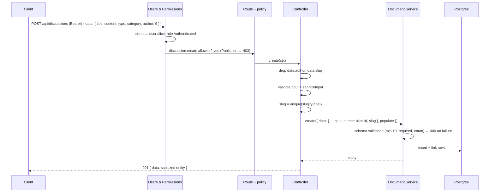
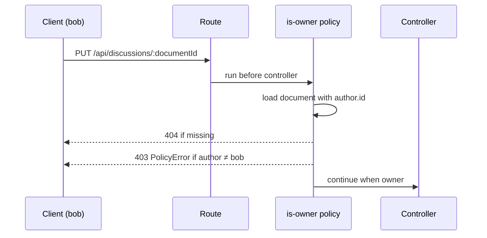

# 02 — Strapi content types, permissions, seed and tests

Branch: `feature/cms-content-types` · Target: `development` · Estimate: 12 h · Status: done

## 1. Goal

After this branch, Strapi exposes the whole forum API the brief asks for, enforces every rule itself, and ships with demo data. A reader can list, filter, sort and paginate discussions, read one with its replies, log in as a demo user, create a discussion and reply. Nobody can post without a token, post as someone else, bypass the 10-character title rule, or edit another member's post. Eight test files prove it against PostgreSQL.

Brief lines served: section 2.A to 2.D (features), section 3 (backend architecture), section 6 (tests), and the deliverables "configuration PostgreSQL et schémas", "mécanisme d'initialisation des données", "tests automatisés".

## 2. Scope

**In**

- Content types `Category` (localised fr/en), `Discussion`, `Reply`, Draft & Publish off.
- Permissions for Public and Authenticated, set in code at boot. Sign-up stays open (the site has a sign-up page; decided during Phase B).
- Controllers: forced author, server-made slug, forced populate, reply count, lookup by slug, delete with reply cascade, output shaping so `author` is exposed as `{ id, documentId, username }` only.
- `is-owner` policy on update and delete.
- Demo data: 3 users, 11 categories in two languages, 12 discussions, ~25 replies.
- Test harness (Vitest + supertest over HTTP against a Strapi instance started once per run on `lerevenu_test`) and the test files of section 7.
- CI job `test-cms` with a Postgres service container.
- `.env.ci` for CI (copied to `.env` in the job), TypeScript migration adding an index on `discussions.created_at`.
- README sections: demo accounts, seed, API table, how to run the integration tests, permissions matrix link.
- **SQLite zero-setup mode** (asked by the job post: "base de données SQLite locale permettant de tester votre travail"): `DATABASE_CLIENT=sqlite` support, `better-sqlite3` dependency, `pnpm --filter cms dev:sqlite`, a pre-seeded `apps/cms/database/demo.sqlite` committed for the reviewer, copied to `.tmp/data.db` at run time so the committed file never changes. PostgreSQL stays the primary database (brief, CI, Docker, tests).

**Out**

- Votes, best answer, search beyond title filter, user profile (bonus, later or never).
- Webhook registration in bootstrap (branch 04 with the Next revalidate handler).
- Anything in `apps/web`.

## 3. Acceptance criteria

1. `GET /api/discussions` returns paginated items with `title, slug, type, createdAt, author.username, category.{name,slug,color}, replies.count`, never `author.email`.
2. `?filters[category][slug][$eq]=bourse`, `?sort=createdAt:asc|desc`, `?pagination[page]=2&pagination[pageSize]=5` work; `pageSize` is capped at 50.
3. `GET /api/discussions/slug/:slug` returns the discussion with `content` and ordered replies, 404 for an unknown slug.
4. `POST /api/discussions` without a token answers 403; with an invalid token 401.
5. `POST /api/discussions` with a title under 10 characters answers 400 `ValidationError` naming `title`.
6. `POST /api/discussions` with `data.author` set to another user answers 201 and the stored author is the caller.
7. `POST /api/replies` has the same three behaviours and answers 404 for an unknown discussion.
8. `PUT`/`DELETE` on another member's discussion or reply answers 403; on your own, 200/204. Deleting a discussion also deletes its replies (no orphans). An owner cannot change `author` on update, nor move a reply to another discussion.
9. `POST /api/auth/local` with a demo account answers `{ jwt, user }`; `POST /api/auth/local/register` creates an Authenticated reader (sign-up open), answers 400 for an invalid or duplicate email.
10. `GET /api/categories?locale=en` returns English names; without `locale`, French.
11. A fresh database boots with the demo data; a second boot does not duplicate it.
12. Every response exposes `author` as exactly `{ documentId, username }`; no numeric `id` and no `email` appear anywhere in list or detail responses.
13. The test files of section 7 pass locally and in CI; `pnpm verify` is green.
14. From a fresh clone with no Docker, `pnpm install && pnpm --filter cms dev:sqlite` boots Strapi on the committed `demo.sqlite` with the demo data present; the same command on an empty SQLite file seeds it.

## 4. Mockups

### Entities

See `docs/data-model.md` for the diagram. Field-level constraints:

| Type       | Field       | Type         | Rules                                            |
| ---------- | ----------- | ------------ | ------------------------------------------------ |
| Category   | name        | string       | required, unique, max 80, localised              |
|            | slug        | uid ← name   | required, shared across locales (not localised)  |
|            | description | text         | required, max 300, localised                     |
|            | color       | string       | optional, `#rrggbb`                              |
| Discussion | title       | string       | required, min 10, max 150                        |
|            | slug        | uid ← title  | required, server-made                            |
|            | content     | text         | required, max 20 000                             |
|            | type        | enum         | `question` \| `discussion`, default `discussion` |
|            | author      | → user       | forced from session                              |
|            | category    | → category   | required                                         |
|            | replies     | ← reply      |                                                  |
| Reply      | content     | text         | required, min 2, max 5 000                       |
|            | author      | → user       | forced from session                              |
|            | discussion  | → discussion | required, must exist                             |

### API contract

| Method · path                                     | Auth           | Body                                               | Answers                           |
| ------------------------------------------------- | -------------- | -------------------------------------------------- | --------------------------------- |
| `GET /api/categories?locale=fr\|en`               | public         | —                                                  | 200 list                          |
| `GET /api/discussions?filters…&sort…&pagination…` | public         | —                                                  | 200 `{ data[], meta.pagination }` |
| `GET /api/discussions/slug/:slug`                 | public         | —                                                  | 200 · 404                         |
| `POST /api/discussions`                           | Bearer         | `{ data: { title, content, type, category } }`     | 201 · 400 · 403                   |
| `PUT /api/discussions/:documentId`                | Bearer + owner | `{ data: { title?, content?, type?, category? } }` | 200 · 400 · 403 · 404             |
| `DELETE /api/discussions/:documentId`             | Bearer + owner | —                                                  | 204 · 403 · 404                   |
| `POST /api/replies`                               | Bearer         | `{ data: { content, discussion } }`                | 201 · 400 · 403 · 404             |
| `PUT` / `DELETE /api/replies/:documentId`         | Bearer + owner |                                                    | 200/204 · 403 · 404               |
| `POST /api/auth/local`                            | —              | `{ identifier, password }`                         | 200 `{ jwt, user }` · 400         |
| `GET /api/users/me`                               | Bearer         | —                                                  | 200 user · 401                    |

List item example:

```json
{
  "id": 7,
  "documentId": "k7q2m9x1c0d3e4f5g6h7i8j9",
  "title": "Faut-il ouvrir un PER à 45 ans ?",
  "slug": "faut-il-ouvrir-un-per-a-45-ans",
  "type": "question",
  "createdAt": "2026-10-20T08:12:00.000Z",
  "author": { "id": 3, "documentId": "…", "username": "alice" },
  "category": {
    "id": 2,
    "documentId": "…",
    "name": "Retraite",
    "slug": "retraite",
    "color": "#ff2d55"
  },
  "replies": { "count": 3 }
}
```

Error example (title too short):

```json
{
  "data": null,
  "error": {
    "status": 400,
    "name": "ValidationError",
    "message": "title must be at least 10 characters",
    "details": {
      "errors": [
        {
          "path": ["title"],
          "message": "title must be at least 10 characters",
          "name": "ValidationError"
        }
      ]
    }
  }
}
```

### Create a discussion (sequence)



### Owner check on update (sequence)



## 5. Design

Short form. Every line below was checked against the Strapi 5.59 source or docs (see `docs/plans/02-review-notes` in the PR description).

### Schemas

| Item               | Decision                                                                                                                  |
| ------------------ | ------------------------------------------------------------------------------------------------------------------------- |
| Location           | `src/api/<type>/content-types/<type>/schema.json`                                                                         |
| Draft & Publish    | off on all three (validator skips `required`/`minLength` on drafts; drafts hidden from reads) → ADR-0008                  |
| Category i18n      | `pluginOptions.i18n.localized: true` on the type and on `name`, `description` only; `slug`, `color` shared across locales |
| Discussion slug    | `uid` + `"column": { "unique": true }` = real DB unique index (attribute-level `unique` is validator-only in v5)          |
| Relations          | `author` → user (no inverse) · `category` ↔ `discussions` · `discussion` ↔ `replies`                                      |
| Required relations | enforced by `documents.strictRelations: true` (already set); an unknown target is a 400 regardless                        |

### Controllers (≤ 100 lines each, helpers in services)

| Action                  | What it does                                                                                                                                                                      |
| ----------------------- | --------------------------------------------------------------------------------------------------------------------------------------------------------------------------------- |
| `discussion.find`       | force populate (author username · category name/slug/color · replies count), default sort `createdAt:desc`, client filters/sort/pagination pass through, `pageSize` clamped to 50 |
| `discussion.findBySlug` | one discussion by slug with replies (author username, oldest first); 404 if none                                                                                                  |
| `discussion.create`     | drop `author` + `slug` from body → validate → make slug → create with `author = ctx.state.user.id` → 201                                                                          |
| `discussion.update`     | drop `author` + `slug`; core behaviour otherwise                                                                                                                                  |
| `discussion.delete`     | replies + discussion in one transaction → 204                                                                                                                                     |
| `reply.create`          | drop `author`; target discussion must exist (404); create with forced author → 201                                                                                                |
| `reply.update`          | drop `author` + `discussion`                                                                                                                                                      |
| `reply.find`            | force author populate, shaped output                                                                                                                                              |

### Output shaping

- Strapi strips any relation whose target the caller can't `find`. Readers never get `user.find` (it would expose `/api/users` and emails).
- So controllers sanitise the entity **without** `author`/`replies`, then re-attach `{ documentId, username }` and the mapped replies (`utils/presenter.ts`).
- **No numeric ids leave the API.** The presenter strips `id` from the entity, the author, the category and every reply; only `documentId` (24 random characters, non-sequential) is exposed. Clients reference relations by `documentId`.
- Populate always limits author to `fields: ['username']`. A test asserts the exact key set and the absence of any `id` key.

### Services

| File                     | Role                                                                                                                |
| ------------------------ | ------------------------------------------------------------------------------------------------------------------- |
| `utils/slug.ts`          | `slugify(title)` (lowercase, no accents, hyphens, max 80) + unique suffix `-2`, `-3`; one retry on Postgres `23505` |
| `utils/presenter.ts`     | `pickAuthor`, `mapReplies`, `withoutIds`, populate constants                                                        |
| `services/discussion.ts` | `deleteWithReplies(documentId)` in `strapi.db.transaction`                                                          |

### Policy and routes

| Item         | Decision                                                                                                                             |
| ------------ | ------------------------------------------------------------------------------------------------------------------------------------ |
| `is-owner`   | one per type; loads the document with `author.id`; 404 if missing, `PolicyError` 403 if not the owner                                |
| Registration | `createCoreRouter(uid, { config: { update: { policies: ['is-owner'] }, delete: { policies: ['is-owner'] } } })`                      |
| Slug route   | `routes/01-slug.ts` → `GET /discussions/slug/:slug` → `discussion.findBySlug`; permission id `api::discussion.discussion.findBySlug` |

### Permissions (bootstrap, additive, idempotent)

| Role          | Actions                                                                             |
| ------------- | ----------------------------------------------------------------------------------- |
| Public        | `category.find/findOne`, `discussion.find/findOne/findBySlug`, `reply.find/findOne` |
| Authenticated | Public + `discussion.create/update/delete`, `reply.create/update/delete`            |
| Never         | `user.find`                                                                         |

- Sign-up on by **merging** `{ allow_register: true, default_role: 'authenticated' }` into the existing `advanced` store object (replacing it breaks login).
- 403 for anonymous writes holds because Public has ≥ 1 permission (zero permissions would give 401).
- Never delete rows: Users & Permissions defaults (`user.me`, `auth.*`) must survive.

### Seed

| Item        | Decision                                                                                                                                                     |
| ----------- | ------------------------------------------------------------------------------------------------------------------------------------------------------------ |
| Files       | `src/seed/{users,categories,discussions,index}.ts`, data in `src/seed/data/*.ts`, ≤ 150 lines each                                                           |
| Trigger     | `bootstrap()` when `SEED_DEMO_DATA=true` and `count(category) === 0`; also `pnpm --filter cms seed` (`scripts/seed.ts`)                                      |
| Atomicity   | whole seed in one `strapi.db.transaction` (a failure leaves the guard at zero)                                                                               |
| Users       | `users-permissions` user service `add({ username, email, password, role, confirmed: true, provider: 'local' })`; password hashed by Strapi; `role` mandatory |
| Categories  | `create({ locale: 'fr' })` then `update({ documentId, locale: 'en', data: { name, description } })` (documented on the REST locale page)                     |
| Discussions | connect `category` and `author` by id; `createdAt` set explicitly, spread over 30 days                                                                       |

### Config

| File                          | Change                                                                       |
| ----------------------------- | ---------------------------------------------------------------------------- |
| `config/database.ts`          | `settings.useTypescriptMigrations: true`; keeps the postgres / sqlite switch |
| `config/server.ts`            | `cron.enabled: false`; dead `webhooks.populateRelations` removed             |
| `config/env/test/database.ts` | `lerevenu_test`                                                              |
| `config/env/test/plugins.ts`  | `users-permissions.ratelimit.enabled: false`                                 |
| `.env.ci`                     | non-secret values, `STRAPI_TELEMETRY_DISABLED=true`; CI copies it to `.env`  |

### SQLite zero-setup mode

| Item        | Decision                                                                                                             |
| ----------- | -------------------------------------------------------------------------------------------------------------------- |
| Why         | job post asks for a local SQLite DB to test the work                                                                 |
| Switch      | `DATABASE_CLIENT=sqlite`, `DATABASE_FILENAME=.tmp/data.db`, `better-sqlite3` dependency                              |
| Scripts     | `scripts/sqlite-reset.ts` copies `database/demo.sqlite` → `.tmp/data.db`; `dev:sqlite` runs it then `strapi develop` |
| Deliverable | `database/demo.sqlite` committed, seeded once in Phase B, refreshed only when seed data changes                      |

### Index

- `database/migrations/2026.10.25T00.00.00.add-discussions-created-at-index.ts`, `export default { up }` (no down migrations in Strapi), portable knex `alterTable().index()`, guarded.

### Test harness

| Item         | Decision                                                                                                                                                |
| ------------ | ------------------------------------------------------------------------------------------------------------------------------------------------------- |
| Pre-step     | `tsc --outDir .tmp/test-dist` before `vitest run` (`strapi ts:compile` does not exist in 5.59; a separate out dir never collides with `strapi develop`) |
| Global setup | reset `lerevenu_test` schema → `createStrapi({ appDir, distDir: 'dist' }).load()` → `listen()` on 1338 → log in 3 users → `provide(baseUrl, tokens)`    |
| Tests        | over HTTP with `supertest(inject('baseUrl'))`; `fileParallelism: false`                                                                                 |
| Why HTTP     | Vitest's global setup runs in another process; the Strapi instance can't be shared                                                                      |
| Fallback     | `strapi start` in a child process with the same `provide`                                                                                               |

## 6. Phases and steps

### Phase A — Schemas and config (1 h)

1. `chore(web)`: untrack and ignore `fr.d.json.ts` (done, first commit of the branch).
2. Three `schema.json` (D&P off, i18n on Category `name`/`description`, `unique` on `discussion.slug`) plus the minimal `controllers/routes/services` files.
3. `config/database.ts` `useTypescriptMigrations`; `config/server.ts` cron off + dead webhook key removed; `config/env/test/{database,plugins}.ts`; the index migration (`up` only).
4. Boot, check tables, the `strapi_migrations` row and the index; `ts:generate-types`, commit.
   Exit: admin shows the three types; `\di discussions*` lists the index; `pnpm type-check` green.

### Phase B — Permissions and seed (3 h)

5. `ensure-permissions.ts` (additive) + sign-up on (merge), wired in `bootstrap()`.
6. Seed data files (11 categories fr/en, 12 discussions, ~25 replies, 3 users).
7. Seed modules in a transaction, `scripts/seed.ts` + `seed` script; boot twice, counts unchanged.
8. curl: `?locale=en` categories, list filter/sort/pagination, `pageSize=100` clamped, register → 200.
9. SQLite: add `better-sqlite3`, `dev:sqlite` + `sqlite-reset` scripts, boot on an empty `.tmp/data.db`, verify the seed, copy the file to `database/demo.sqlite` and commit it; boot again from the committed copy.
   Exit: criteria 2, 9 (register), 10, 11, 14 by hand.

### Phase C — Controllers, services, policies (3 h)

9. `utils/slug.ts` and `utils/presenter.ts` (helpers must not live in `services/`: Strapi auto-loads that folder).
10. `discussion` controller (find, findBySlug, create, update, delete with cascade) + `01-slug` route.
11. `reply` controller (create with 404, update strips `discussion`, find).
12. Two `is-owner` policies + router config.
13. curl pass for criteria 1, 3–8, 12: author spoof, unknown category (400), unknown discussion on reply (404), delete cascade.
    Exit: every criterion by hand; `author` present with `documentId, username` only; no `id` key anywhere.

### Phase D — Tests and CI (3 h)

14. `vitest.config.mts`, `tests/global-setup.ts` (after `tsc --outDir .tmp/test-dist`), `tests/helpers/api.ts`, `.env.ci` (telemetry off).
15. Test files from section 7.
16. `test-cms` job in `ci.yml` (Postgres service with healthcheck, `.env.ci` copy).
    Exit: `pnpm --filter cms test:integration` green locally and in CI twice in a row.

### Phase E — Docs (1 h)

17. ADR-0008; README sections (demo accounts, seed, API table, tests, permissions link); `docs/data-model.md` and `docs/plans/README.md` updated.
18. `pnpm verify`, push, PR with the curl transcript.

Total 11 h; 12 h kept as the estimate.

## 7. Tests

`apps/cms/tests/`, Vitest + supertest over HTTP, demo data seeded once per run, files run sequentially.

| #   | File                             | Brief area         | Cases                                                                                                                                                                                                                                                                                                                        | Criteria    |
| --- | -------------------------------- | ------------------ | ---------------------------------------------------------------------------------------------------------------------------------------------------------------------------------------------------------------------------------------------------------------------------------------------------------------------------- | ----------- |
| 1   | `discussions.validation.test.ts` | validation         | title 9 chars → 400 `ValidationError`, `details.errors[].path` contains `title`; missing `content` → 400; `type: 'rant'` → 400; unknown `category` → 400; content > 20 000 → 400                                                                                                                                             | 5           |
| 2   | `discussions.auth.test.ts`       | unauthenticated    | no token → 403 `ForbiddenError`; malformed token → 401 `UnauthorizedError`; `POST /api/auth/local/register` → 200 `{ jwt, user }` without `password`, duplicate email → 400, invalid email → 400                                                                                                                             | 4, 9        |
| 3   | `discussions.author.test.ts`     | author spoofing    | alice posts with `data.author = bob.id` → 201, `author.username === 'alice'`; alice updates her own with `data.author = bob.id` → 200, author unchanged; `data.slug` ignored                                                                                                                                                 | 6           |
| 4   | `discussions.list.test.ts`       | display            | list item keys exactly `title, slug, type, createdAt, author{documentId,username}, category{name,slug,color}, replies{count}` (+ ids/timestamps); no `email` anywhere in the JSON; `sort=createdAt:asc` ordered; `pageSize=2` → 2; `pageSize=100` → 50; category filter; slug route with ordered replies; unknown slug → 404 | 1, 2, 3, 12 |
| 5   | `replies.test.ts`                | validation + spoof | no token → 403; spoofed author → 201 with caller; unknown discussion → 404; content 1 char → 400                                                                                                                                                                                                                             | 7           |
| 6   | `ownership.test.ts`              | permissions        | bob PUT alice's discussion → 403 `PolicyError`; bob DELETE alice's reply → 403; alice PUT own → 200; alice DELETE own discussion with 2 replies → 204 and replies gone; unknown id → 404                                                                                                                                     | 8           |
| 7   | `auth.test.ts`                   | smoke              | alice login → 200 `{ jwt, user }`, `user` has no `password`; wrong password → 400; `GET /api/users/me` with jwt → 200, without → 403 (holds because Public has ≥ 1 permission: asserted first); `GET /api/users` with jwt → 403                                                                                              | 9           |
| +   | `categories.test.ts`             |                    | `?locale=en` names in English, same `documentId` and `slug` as French; default locale French                                                                                                                                                                                                                                 | 10          |

Seed idempotence (criterion 11) stays a manual check (boot twice, counts unchanged) plus a unit test of the guard function.

## 8. Manual verification

- [ ] Admin → Content Manager shows seeded categories in fr and en
- [ ] Admin → Settings → Roles → Public and Authenticated show the expected ticks
- [ ] `GET /api/users` → 403 for everyone
- [ ] No `email` anywhere in a list or detail response
- [ ] Second boot: counts unchanged
- [ ] CI `test-cms` green

## 9. Risks and open questions

| Risk                                                      | Mitigation                                                                                                               |
| --------------------------------------------------------- | ------------------------------------------------------------------------------------------------------------------------ |
| `sanitizeOutput` strips `author` (no `user.find`)         | Presenter re-attaches a picked author; test 4 asserts the key set                                                        |
| `populate[replies][count]` undocumented on the REST page  | Verified in Strapi's query converter and DB populate; forced server-side; test 4 asserts it                              |
| TS migration not discovered                               | `useTypescriptMigrations: true`; Phase A checks the index exists                                                         |
| `globalSetup` cannot share the instance with workers      | HTTP harness with `provide/inject`; `tsc` pre-step; Strapi loaded with `createRequire` (its ESM build breaks under Vite) |
| U&P rate limit (10/min) on `/auth/local`                  | `ratelimit.enabled: false` in the test env config; tokens still obtained once in `globalSetup`                           |
| Slug race                                                 | `column.unique` index on `discussion.slug` + one retry on Postgres `23505`                                               |
| Partial seed with the count guard                         | Seed runs in one transaction                                                                                             |
| Category relation points at the French row                | Documented; frontend resolves by `documentId` with locale fallback                                                       |
| Committed `demo.sqlite` drifts from the seed data         | Regenerated by a script, refreshed in the same commit as any seed change; tests run on Postgres                          |
| SQLite behaves differently from Postgres (types, indexes) | Document Service abstracts it; the index migration is portable; CI stays on Postgres                                     |

## 10. Definition of done

- [x] All acceptance criteria met
- [x] Tests in section 7 green locally (41 tests, twice in a row)
- [x] Manual checklist done
- [x] ADR-0008 written, README sections added, `docs/plans/README.md` updated, this plan set to done
- [x] PR opened against `development`
