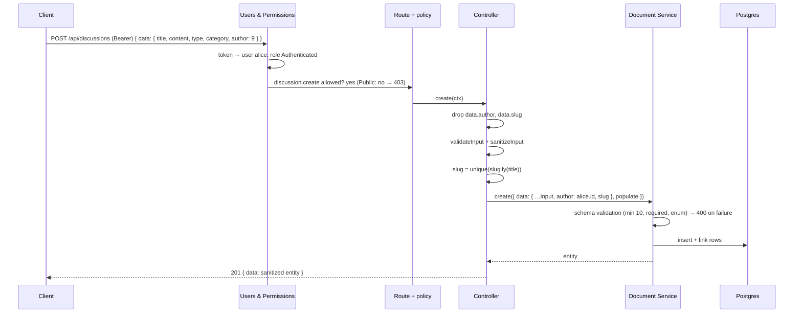
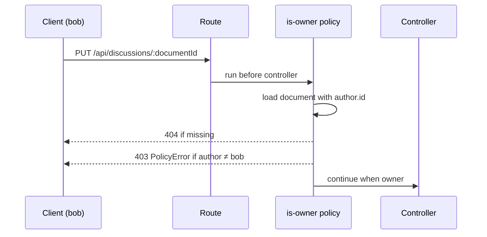

# 02 — Strapi content types, permissions, seed and tests

Branch: `feature/cms-content-types` · Target: `development` · Estimate: 12 h · Status: draft

## 1. Goal

After this branch, Strapi exposes the whole forum API the brief asks for, enforces every rule itself, and ships with demo data. A reader can list, filter, sort and paginate discussions, read one with its replies, log in as a demo user, create a discussion and reply. Nobody can post without a token, post as someone else, bypass the 10-character title rule, or edit another member's post. Seven automated tests prove it against PostgreSQL.

Brief lines served: section 2.A to 2.D (features), section 3 (backend architecture), section 6 (tests), and the deliverables "configuration PostgreSQL et schémas", "mécanisme d'initialisation des données", "tests automatisés".

## 2. Scope

**In**

- Content types `Category` (localised fr/en), `Discussion`, `Reply`, Draft & Publish off.
- Permissions for Public and Authenticated, set in code at boot. Sign-up disabled.
- Controllers: forced author, server-made slug, forced populate, reply count, lookup by slug, delete with reply cascade, output shaping so `author` is exposed as `{ id, documentId, username }` only.
- `is-owner` policy on update and delete.
- Demo data: 3 users, 11 categories in two languages, 12 discussions, ~25 replies.
- Test harness (Vitest + supertest over HTTP against a Strapi instance started once per run on `lerevenu_test`) and the test files of section 7.
- CI job `test-cms` with a Postgres service container.
- `.env.ci` for CI (copied to `.env` in the job), TypeScript migration adding an index on `discussions.created_at`.
- README sections: demo accounts, seed, API table, how to run the integration tests, permissions matrix link.

**Out**

- Votes, best answer, search beyond title filter, user profile (bonus, later or never).
- Webhook registration in bootstrap (branch 04 with the Next revalidate handler).
- Anything in `apps/web`.

## 3. Acceptance criteria

1. `GET /api/discussions` returns paginated items with `title, slug, type, createdAt, author.username, category.{name,slug,color}, replies.count`, never `author.email`.
2. `?filters[category][slug][$eq]=bourse`, `?sort=createdAt:asc|desc`, `?pagination[page]=2&pagination[pageSize]=5` work; `pageSize` is capped at 50.
3. `GET /api/discussions/slug/:slug` returns the discussion with `content` and ordered replies, 404 for an unknown slug.
4. `POST /api/discussions` without a token answers 403; with an invalid token 401.
5. `POST /api/discussions` with a title under 10 characters answers 400 `ValidationError` naming `title`.
6. `POST /api/discussions` with `data.author` set to another user answers 201 and the stored author is the caller.
7. `POST /api/replies` has the same three behaviours and answers 404 for an unknown discussion.
8. `PUT`/`DELETE` on another member's discussion or reply answers 403; on your own, 200/204. Deleting a discussion also deletes its replies (no orphans). An owner cannot change `author` on update, nor move a reply to another discussion.
9. `POST /api/auth/local` with a demo account answers `{ jwt, user }`; `POST /api/auth/local/register` answers 400 (sign-ups disabled).
10. `GET /api/categories?locale=en` returns English names; without `locale`, French.
11. A fresh database boots with the demo data; a second boot does not duplicate it.
12. Every response exposes `author` as exactly `{ id, documentId, username }`; `email` never appears.
13. The test files of section 7 pass locally and in CI; `pnpm verify` is green.

## 4. Mockups

### Entities

See `docs/data-model.md` for the diagram. Field-level constraints:

| Type       | Field       | Type         | Rules                                            |
| ---------- | ----------- | ------------ | ------------------------------------------------ |
| Category   | name        | string       | required, unique, max 80, localised              |
|            | slug        | uid ← name   | required, shared across locales (not localised)  |
|            | description | text         | required, max 300, localised                     |
|            | color       | string       | optional, `#rrggbb`                              |
| Discussion | title       | string       | required, min 10, max 150                        |
|            | slug        | uid ← title  | required, server-made                            |
|            | content     | text         | required, max 20 000                             |
|            | type        | enum         | `question` \| `discussion`, default `discussion` |
|            | author      | → user       | forced from session                              |
|            | category    | → category   | required                                         |
|            | replies     | ← reply      |                                                  |
| Reply      | content     | text         | required, min 2, max 5 000                       |
|            | author      | → user       | forced from session                              |
|            | discussion  | → discussion | required, must exist                             |

### API contract

| Method · path                                     | Auth           | Body                                               | Answers                           |
| ------------------------------------------------- | -------------- | -------------------------------------------------- | --------------------------------- |
| `GET /api/categories?locale=fr\|en`               | public         | —                                                  | 200 list                          |
| `GET /api/discussions?filters…&sort…&pagination…` | public         | —                                                  | 200 `{ data[], meta.pagination }` |
| `GET /api/discussions/slug/:slug`                 | public         | —                                                  | 200 · 404                         |
| `POST /api/discussions`                           | Bearer         | `{ data: { title, content, type, category } }`     | 201 · 400 · 403                   |
| `PUT /api/discussions/:documentId`                | Bearer + owner | `{ data: { title?, content?, type?, category? } }` | 200 · 400 · 403 · 404             |
| `DELETE /api/discussions/:documentId`             | Bearer + owner | —                                                  | 204 · 403 · 404                   |
| `POST /api/replies`                               | Bearer         | `{ data: { content, discussion } }`                | 201 · 400 · 403 · 404             |
| `PUT` / `DELETE /api/replies/:documentId`         | Bearer + owner |                                                    | 200/204 · 403 · 404               |
| `POST /api/auth/local`                            | —              | `{ identifier, password }`                         | 200 `{ jwt, user }` · 400         |
| `GET /api/users/me`                               | Bearer         | —                                                  | 200 user · 401                    |

List item example:

```json
{
  "id": 7,
  "documentId": "k7q2m9x1c0d3e4f5g6h7i8j9",
  "title": "Faut-il ouvrir un PER à 45 ans ?",
  "slug": "faut-il-ouvrir-un-per-a-45-ans",
  "type": "question",
  "createdAt": "2026-10-20T08:12:00.000Z",
  "author": { "id": 3, "documentId": "…", "username": "alice" },
  "category": {
    "id": 2,
    "documentId": "…",
    "name": "Retraite",
    "slug": "retraite",
    "color": "#ff2d55"
  },
  "replies": { "count": 3 }
}
```

Error example (title too short):

```json
{
  "data": null,
  "error": {
    "status": 400,
    "name": "ValidationError",
    "message": "title must be at least 10 characters",
    "details": {
      "errors": [
        {
          "path": ["title"],
          "message": "title must be at least 10 characters",
          "name": "ValidationError"
        }
      ]
    }
  }
}
```

### Create a discussion (sequence)



### Owner check on update (sequence)



## 5. Design

**Schemas** live in `src/api/<type>/content-types/<type>/schema.json` with `"options": { "draftAndPublish": false }`. Category has `"pluginOptions": { "i18n": { "localized": true } }` at the root and on `name` and `description` only; `slug` and `color` are shared across locales, so an English version only carries its own name and description and the slug is identical by construction. `discussion.slug` is `uid` with `"column": { "unique": true }` (the documented way to get a real Postgres unique index; attribute-level `unique` is validator-only in Strapi 5, which even drops old slug unique indexes on upgrade). Safe because the type is neither localised nor draft-published. `category.name` keeps attribute-level `unique`, enforced by the validator per locale. Relations: `author` is `manyToOne` to `plugin::users-permissions.user` with no inverse; `category` is `manyToOne` with inverse `discussions`; `discussion` on Reply is `manyToOne` with inverse `replies`. An unknown relation target is always a 400 `ValidationError` in Strapi 5. `config/api.ts` sets `documents.strictRelations: true`, whose only effect is to enforce `required` on relations, which we need for `category` and `discussion`.

**Why D&P is off:** the entity validator applies `required`, `minLength` and uniqueness only when the entry is not a draft, and unpublished entries are hidden from reads. Written in ADR-0008.

**Output shaping (author).** `sanitizeOutput` removes every relation whose target the caller cannot `find`; neither role gets `user.find`, so Strapi would strip `author` from every response. Controllers therefore sanitise the entity without its `author`/`replies` and re-attach a picked shape through `services/presenter.ts`: `pickAuthor → { id, documentId, username }`, `mapReplies → [{ id, documentId, content, createdAt, author }]`. The populate always requests `author: { fields: ['username'] }` so nothing else is ever loaded. A test asserts the `author` key set is exactly `id, documentId, username`.

**Controllers** (`createCoreController` overrides, ≤ 100 lines each; constants and mappers in services):

- `discussion.find`: force `populate = { author: { fields: ['username'] }, category: { fields: ['name','slug','color'] }, replies: { count: true } }`, default `sort = ['createdAt:desc']`; client `filters`, `sort`, `pagination` pass through `validateQuery`/`sanitizeQuery` (`pageSize` is clamped to `rest.maxLimit` = 50, no error).
- `discussion.findBySlug`: `documents().findMany({ filters: { slug }, limit: 1, populate: … replies: { populate: { author: { fields: ['username'] } }, sort: ['createdAt:asc'] } })`; 404 `NotFoundError` when empty.
- `discussion.create`: delete `data.author` and `data.slug`, `validateInput` (otherwise 400 "Invalid key author", since the caller lacks `user.find`), `sanitizeInput`, `slug = await slugService.unique(title)`, `documents().create({ data: { …input, author: ctx.state.user.id, slug }, populate })`, shape, 201.
- `discussion.update`: delete `data.author`, `data.slug` (URL stays stable when the title changes); core behaviour otherwise.
- `discussion.delete`: `services/discussion.deleteWithReplies(documentId)` removes replies and the discussion in one `strapi.db.transaction`; 204.
- `reply.create`: delete `data.author`; `documents('api::discussion.discussion').findOne({ documentId })` → 404 `NotFoundError` when missing; create with forced author; 201 with shaped author.
- `reply.update`: delete `data.author` and `data.discussion`.
- `reply.find`: force `populate.author.fields = ['username']`, shaped output.

**Slug:** `src/api/discussion/services/slug.ts`: `slugify(title)` (lowercase, accents stripped, `[^a-z0-9]+` → `-`, trimmed, max 80), `unique(title)` queries existing slugs with `$startsWith` and appends `-2`, `-3`…; the create call catches a Postgres `23505` unique violation once and retries with the next suffix. The content-manager UID service is not used (admin-only, undocumented for API code).

**Policy** `src/api/discussion/policies/is-owner.ts` and `src/api/reply/policies/is-owner.ts`, registered in `routes/<type>.ts` through `createCoreRouter(uid, { config: { update: { policies: ['is-owner'] }, delete: { policies: ['is-owner'] } } })`. The policy loads the document by `policyContext.params.id` with `populate: { author: { fields: ['id'] } }`, throws `NotFoundError` (404) when missing and `PolicyError` (403) when `author.id !== policyContext.state.user.id`.

**Custom route** `src/api/discussion/routes/01-slug.ts`: `GET /discussions/slug/:slug` → `discussion.findBySlug` (no path conflict with `/discussions/:id`; the numeric prefix is the documented convention). Its permission id is `api::discussion.discussion.findBySlug`.

**Permissions** `src/bootstrap/ensure-permissions.ts`, idempotent and additive: find roles by `type`, insert missing `plugin::users-permissions.permission` rows, never delete (the Users & Permissions defaults `user.me` and `auth.*` must survive). Public: `category.find/findOne`, `discussion.find/findOne/findBySlug`, `reply.find/findOne`. Authenticated: same plus `discussion.create/update/delete`, `reply.create/update/delete`. Never `user.find`. Sign-up off by merging `{ allow_register: false }` into the existing `advanced` object of `strapi.store({ type: 'plugin', name: 'users-permissions' })` (replacing the object would break login). A write without token is 403 only because Public holds at least one permission (with zero permissions Strapi answers 401); the bootstrap order guarantees it.

**Seed** `src/seed/` (`users.ts`, `categories.ts`, `discussions.ts`, `index.ts`, data under `src/seed/data/*.ts`), each ≤ 150 lines. Runs from `bootstrap()` when `SEED_DEMO_DATA=true` and `count(category) === 0`, inside one `strapi.db.transaction` so a failure leaves the guard at zero. Also `pnpm --filter cms seed`, backed by `scripts/seed.ts` (compiled by the existing tsconfig, runs `createStrapi().load()` → `seed(strapi)` → `destroy()`). Users via `strapi.plugin('users-permissions').service('user').add({ username, email, password, role: authenticated.id, confirmed: true, provider: 'local' })` (bcrypt applied by the Document Service; `role` is mandatory or every call answers 401). Categories: `create({ locale: 'fr', data })` then `update({ documentId, locale: 'en', data: { name, description } })` (documented on the REST locale page: an update with a locale "creates the locale version or updates it if it already exists"). Discussions connect `category` and `author` by id; `createdAt` passed explicitly and spread over 30 days (the timestamp hook only fills missing values; confirmed with one curl in Phase B). Replies created after discussions, 1–4 each.

**Config:** `config/database.ts` adds `settings: { useTypescriptMigrations: true }` (without it a `.ts` migration is never discovered). `config/server.ts`: `cron: { enabled: false }` (source default is true, docs say false; we have no cron tasks) and the dead `webhooks.populateRelations` key removed (ignored since v5). `config/env/test/database.ts` → `lerevenu_test`; `config/env/test/plugins.ts` → `users-permissions.ratelimit.enabled: false` (documented option) so the login budget never flakes tests. `.env.ci` committed with non-secret values that do not match the placeholder regex in `assert-env.ts`, plus `STRAPI_TELEMETRY_DISABLED=true`; CI copies it to `.env` before running Strapi (Strapi only reads `.env` or `ENV_PATH`).

**Index:** `database/migrations/2026.10.25T00.00.00.add-discussions-created-at-index.ts`, `export default { up }` only (Strapi documents no down migrations), `knex.schema.alterTable('discussions', t => t.index(['created_at'], 'discussions_created_at_idx'))`, guarded by `hasTable` and a `pg_indexes` check.

**Test harness** the `test:integration` script runs `strapi ts:compile` first (in-process `compileStrapi` calls `process.exit(1)` on a type error and Vitest would show nothing), then `vitest run`. `tests/global-setup.ts`: reset the `public` schema of `lerevenu_test` with `pg`, `createStrapi({ appDir, distDir: 'dist' }).load()` → `listen()` on port 1338 (`PORT` set in env before creation), log in the three demo users, `provide('baseUrl')` and `provide('tokens')`; teardown `destroy()`. Vitest's `globalSetup` runs in the orchestrator process and test files in workers, so the instance itself is never shared; tests go over HTTP with `supertest(inject('baseUrl'))`; `fileParallelism: false`. Fallback if `compileStrapi` misbehaves under Vitest: `strapi start` in a child process with the same `provide`.

## 6. Phases and steps

### Phase A — Schemas and config (1 h)

1. `chore(web)`: untrack and ignore `fr.d.json.ts` (done, first commit of the branch).
2. Three `schema.json` (D&P off, i18n on Category `name`/`description`, `unique` on `discussion.slug`) plus the minimal `controllers/routes/services` files.
3. `config/database.ts` `useTypescriptMigrations`; `config/server.ts` cron off + dead webhook key removed; `config/env/test/{database,plugins}.ts`; the index migration (`up` only).
4. Boot, check tables, the `strapi_migrations` row and the index; `ts:generate-types`, commit.
   Exit: admin shows the three types; `\di discussions*` lists the index; `pnpm type-check` green.

### Phase B — Permissions and seed (2.5 h)

5. `ensure-permissions.ts` (additive) + sign-up off (merge), wired in `bootstrap()`.
6. Seed data files (11 categories fr/en, 12 discussions, ~25 replies, 3 users).
7. Seed modules in a transaction, `scripts/seed.ts` + `seed` script; boot twice, counts unchanged.
8. curl: `?locale=en` categories, list filter/sort/pagination, `pageSize=100` clamped, register → 400.
   Exit: criteria 2, 9 (register), 10, 11 by hand.

### Phase C — Controllers, services, policies (3 h)

9. `services/slug.ts` and `services/presenter.ts`.
10. `discussion` controller (find, findBySlug, create, update, delete with cascade) + `01-slug` route.
11. `reply` controller (create with 404, update strips `discussion`, find).
12. Two `is-owner` policies + router config.
13. curl pass for criteria 1, 3–8, 12: author spoof, unknown category (400), unknown discussion on reply (404), delete cascade.
    Exit: every criterion by hand; `author` present with `id, documentId, username` only.

### Phase D — Tests and CI (3 h)

14. `vitest.config.mts`, `tests/global-setup.ts` (after `strapi ts:compile`), `tests/helpers/api.ts`, `.env.ci` (telemetry off).
15. Test files from section 7.
16. `test-cms` job in `ci.yml` (Postgres service with healthcheck, `.env.ci` copy).
    Exit: `pnpm --filter cms test:integration` green locally and in CI twice in a row.

### Phase E — Docs (1 h)

17. ADR-0008; README sections (demo accounts, seed, API table, tests, permissions link); `docs/data-model.md` and `docs/plans/README.md` updated.
18. `pnpm verify`, push, PR with the curl transcript.

Total 10.5 h; 12 h kept as the estimate.

## 7. Tests

`apps/cms/tests/`, Vitest + supertest over HTTP, demo data seeded once per run, files run sequentially.

| #   | File                             | Brief area         | Cases                                                                                                                                                                                                                                                                                                                           | Criteria    |
| --- | -------------------------------- | ------------------ | ------------------------------------------------------------------------------------------------------------------------------------------------------------------------------------------------------------------------------------------------------------------------------------------------------------------------------- | ----------- |
| 1   | `discussions.validation.test.ts` | validation         | title 9 chars → 400 `ValidationError`, `details.errors[].path` contains `title`; missing `content` → 400; `type: 'rant'` → 400; unknown `category` → 400; content > 20 000 → 400                                                                                                                                                | 5           |
| 2   | `discussions.auth.test.ts`       | unauthenticated    | no token → 403 `ForbiddenError`; malformed token → 401 `UnauthorizedError`; `POST /api/auth/local/register` → 400                                                                                                                                                                                                               | 4, 9        |
| 3   | `discussions.author.test.ts`     | author spoofing    | alice posts with `data.author = bob.id` → 201, `author.username === 'alice'`; alice updates her own with `data.author = bob.id` → 200, author unchanged; `data.slug` ignored                                                                                                                                                    | 6           |
| 4   | `discussions.list.test.ts`       | display            | list item keys exactly `title, slug, type, createdAt, author{id,documentId,username}, category{name,slug,color}, replies{count}` (+ ids/timestamps); no `email` anywhere in the JSON; `sort=createdAt:asc` ordered; `pageSize=2` → 2; `pageSize=100` → 50; category filter; slug route with ordered replies; unknown slug → 404 | 1, 2, 3, 12 |
| 5   | `replies.test.ts`                | validation + spoof | no token → 403; spoofed author → 201 with caller; unknown discussion → 404; content 1 char → 400                                                                                                                                                                                                                                | 7           |
| 6   | `ownership.test.ts`              | permissions        | bob PUT alice's discussion → 403 `PolicyError`; bob DELETE alice's reply → 403; alice PUT own → 200; alice DELETE own discussion with 2 replies → 204 and replies gone; unknown id → 404                                                                                                                                        | 8           |
| 7   | `auth.test.ts`                   | smoke              | alice login → 200 `{ jwt, user }`, `user` has no `password`; wrong password → 400; `GET /api/users/me` with jwt → 200, without → 403 (holds because Public has ≥ 1 permission: asserted first); `GET /api/users` with jwt → 403                                                                                                 | 9           |
| +   | `categories.test.ts`             |                    | `?locale=en` names in English, same `documentId` and `slug` as French; default locale French                                                                                                                                                                                                                                    | 10          |

Seed idempotence (criterion 11) stays a manual check (boot twice, counts unchanged) plus a unit test of the guard function.

## 8. Manual verification

- [ ] Admin → Content Manager shows seeded categories in fr and en
- [ ] Admin → Settings → Roles → Public and Authenticated show the expected ticks
- [ ] `GET /api/users` → 403 for everyone
- [ ] No `email` anywhere in a list or detail response
- [ ] Second boot: counts unchanged
- [ ] CI `test-cms` green

## 9. Risks and open questions

| Risk                                                     | Mitigation                                                                                       |
| -------------------------------------------------------- | ------------------------------------------------------------------------------------------------ |
| `sanitizeOutput` strips `author` (no `user.find`)        | Presenter re-attaches a picked author; test 4 asserts the key set                                |
| `populate[replies][count]` undocumented on the REST page | Verified in Strapi's query converter and DB populate; forced server-side; test 4 asserts it      |
| TS migration not discovered                              | `useTypescriptMigrations: true`; Phase A checks the index exists                                 |
| `globalSetup` cannot share the instance with workers     | HTTP harness with `provide/inject`; `ts:compile` pre-step; fallback child-process `strapi start` |
| U&P rate limit (10/min) on `/auth/local`                 | `ratelimit.enabled: false` in the test env config; tokens still obtained once in `globalSetup`   |
| Slug race                                                | `column.unique` index on `discussion.slug` + one retry on Postgres `23505`                       |
| Partial seed with the count guard                        | Seed runs in one transaction                                                                     |
| Category relation points at the French row               | Documented; frontend resolves by `documentId` with locale fallback                               |

## 10. Definition of done

- [ ] All acceptance criteria met
- [ ] Tests in section 7 green locally and in CI
- [ ] Manual checklist done
- [ ] ADR-0008 written, README sections added, `docs/plans/README.md` updated, this plan set to done
- [ ] PR opened against `development`
