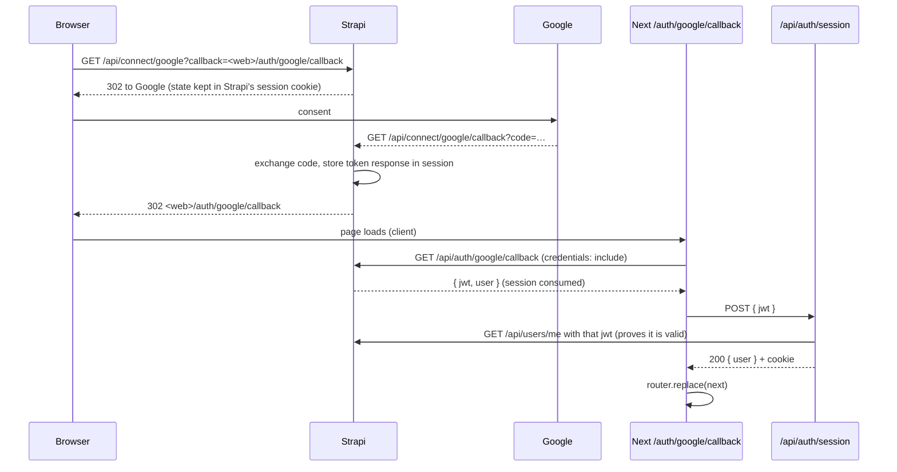

# 04 — Authentication: sign-up, login, Google

Branch: `feature/auth` · Target: `development` · Estimate: 9 h · Status: approved

## 1. Goal

After this branch, a visitor can create an account, log in with email (or username) and password, or with a Google account, and log out. The header shows who is logged in. The session is a httpOnly cookie set by the Next.js app; the browser never stores the Strapi token. Every later form (reply, create a discussion) reuses this session, the form hook and the field components introduced here.

Brief lines served: "Users: Users & Permissions with demo users, every discussion/reply linked to a user, posting forbidden to unauthenticated users" (the session is the prerequisite), "full authentication optional" (we go beyond: sign-up and Google, to show the real thing). Mockup: the "Rejoindre la communauté" modal (email, password, "Pas encore de compte ? Créer un compte gratuit") becomes two pages.

## 2. Scope

**In**

- Strapi: Google provider configured from env at boot (`ensure-providers.ts`, idempotent, enabled only when `GOOGLE_CLIENT_ID` and `GOOGLE_CLIENT_SECRET` are set), absolute `server.url` (required by OAuth), CORS already allows credentials from the web origin.
- BFF route handlers: `POST /api/auth/login`, `POST /api/auth/register`, `POST /api/auth/logout`, `GET /api/auth/me`, `POST /api/auth/session` (Google exchange). Session cookie helper. Same-origin check on every write.
- `features/auth`: zod schemas, `getCurrentUser()` DAL, `useCurrentUser()` hook, mutations (`useLogin`, `useRegister`, `useLogout`), components `LoginForm`, `RegisterForm`, `GoogleButton`, `UserMenu`, `AuthCard`.
- Form foundation reused by every later form: `hooks/form.ts` (TanStack Form `createFormHook`), `components/form/{text-field,password-field,submit-button}.tsx` on shadcn `Field`.
- Pages: `/login`, `/register` (both with `?next=` validated relative path), `/auth/google/callback` (client page that finishes the Google flow), `/discussions/new` placeholder guard kept in `proxy.ts`.
- Header: "Se connecter" + "S'inscrire" when logged out; avatar initial + username with a menu (Se déconnecter) when logged in; under a Suspense boundary with a skeleton.
- Messages fr + en. Unit tests of section 7. First Playwright spec (login as alice, logout).
- ADR-0009: session cookie, Google flow and its one unavoidable browser exchange.

**Out**

- Forgot password and email confirmation: they need a mailer; listed as evolutions with the exact Strapi settings to flip.
- Profile page, username change, account deletion.
- Linking a Google account to an existing email/password account: Strapi refuses with "Email is already taken" (unique email); we show a clear message and stop there.
- Refresh tokens (`jwtManagement: 'refresh'`): documented evolution in ADR-0001.
- Create and reply forms: branches 05 and 06 (they reuse the form hook built here).

## 3. Acceptance criteria

1. `/register` with a valid username, email and password creates an Authenticated reader in Strapi, logs them in (cookie set) and redirects to `next` or `/discussions`; the header shows the username.
2. `/register` with an email already used answers a field error on the email ("Cet e-mail est déjà utilisé"), a username already used on the username, a password under 8 characters on the password, before any request when caught client-side and after the request when caught by Strapi.
3. `/login` with `alice` / `Password123!` (username or email as identifier) sets the cookie and redirects; a wrong password shows "Identifiant ou mot de passe incorrect" without saying which; the submit button is disabled while the request runs; a 429 from Strapi (10 attempts per minute) shows "Trop de tentatives, réessayez dans une minute".
4. The cookie is `httpOnly`, `SameSite=Lax`, `Secure` in production, 7 days, path `/`; the JWT never appears in any JSON answered by the BFF; `document.cookie` cannot read it.
5. Logout clears the cookie (204) and the header switches back to the logged-out state without a full reload.
6. `GET /api/auth/me` answers the current user `{ documentId, username, email }` with the cookie, 401 without; a cookie holding a bad token is treated as logged out and cleared.
7. Every write handler refuses a cross-origin request (`Origin` or `Sec-Fetch-Site` not same-origin) with 403 and a body that is not JSON with 415.
8. Google: when `NEXT_PUBLIC_GOOGLE_LOGIN=true`, both pages show "Continuer avec Google"; clicking it goes to Strapi's `/api/connect/google`, then Google, then back to `/auth/google/callback`, which finishes the exchange and lands on `next` or `/discussions` logged in as a user whose username derives from the email. When the variable is absent, the button is not rendered. A Google email already registered with a password shows "Un compte existe déjà avec cet e-mail, connectez-vous avec votre mot de passe".
9. `/login` and `/register` redirect to `/discussions` when already logged in; `?next=` only accepts a relative path starting with `/` (no `//`, no scheme).
10. Both pages work at 400 / 760 / 1180 px, light and dark; the form is usable with the keyboard only; errors are announced (`aria-invalid`, `FieldError`, focus moved to the first invalid field on submit).
11. `/en/login` and `/en/register` are English; the Google callback page keeps the locale.
12. Unit tests of section 7 and the Playwright login spec pass; `pnpm verify` green.

## 4. Mockups

### UI features

- `docs/mockups/04-auth/login.html` — login page, desktop and mobile (resize), with the Google button.
- `docs/mockups/04-auth/register.html` — sign-up page, same frame, with the password rule shown under the field.
- `docs/mockups/04-auth/auth-states.html` — header logged out / logged in with the open user menu; form with field errors; form submitting; "wrong credentials" and "too many attempts"; Google callback page (spinner, then its error state).

```
┌──────────────────────────────────────────────────────────────┐
│ LE REVENU · Communauté                  ☾  🇫🇷 Français ▾  Se connecter  [S'inscrire] │
├──────────────────────────────────────────────────────────────┤
│                                                              │
│              ┌──────────────────────────────┐                │
│              │ Se connecter                 │                │
│              │ Retrouvez la communauté…     │                │
│              │ [ G  Continuer avec Google ] │                │
│              │ ─────────── ou ───────────   │                │
│              │ E-mail ou nom d'utilisateur  │                │
│              │ [                          ] │                │
│              │ Mot de passe                 │                │
│              │ [                      👁 ]  │                │
│              │ [       Se connecter       ] │                │
│              │ Pas encore de compte ?       │                │
│              │ Créer un compte gratuit      │                │
│              └──────────────────────────────┘                │
└──────────────────────────────────────────────────────────────┘
Logged in header:  ☾  🇫🇷 Français ▾  (A) alice ▾   →  menu: alice · alice@…  | Se déconnecter
```

### Backend features

No Strapi content type changes. BFF contract:

| Method · path             | Auth   | Body (zod)                         | Answers                                                                        |
| ------------------------- | ------ | ---------------------------------- | ------------------------------------------------------------------------------ |
| `POST /api/auth/login`    | —      | `{ identifier, password }`         | 200 `{ user }` + cookie · 401 `INVALID_CREDENTIALS` · 422 · 429 `RATE_LIMITED` |
| `POST /api/auth/register` | —      | `{ username, email, password }`    | 201 `{ user }` + cookie · 409 `EMAIL_TAKEN` / `USERNAME_TAKEN` · 422           |
| `POST /api/auth/logout`   | cookie | —                                  | 204, cookie cleared                                                            |
| `GET /api/auth/me`        | cookie | —                                  | 200 `{ user }` · 401                                                           |
| `POST /api/auth/session`  | —      | `{ jwt }` from the Google exchange | 200 `{ user }` + cookie · 401 if Strapi rejects the token                      |

`user` is always `{ documentId, username, email }`. Nothing else from Strapi's user object leaves the BFF.

### Login sequence

```mermaid
sequenceDiagram
    participant B as Browser (LoginForm)
    participant H as Route Handler /api/auth/login
    participant S as Strapi
    B->>H: POST { identifier, password } (same-origin, JSON)
    H->>H: zod, origin check
    H->>S: POST /api/auth/local
    S-->>H: 200 { jwt, user } · 400 invalid · 429
    H->>H: Set-Cookie lr_session=jwt; HttpOnly; SameSite=Lax; Path=/; Max-Age=7d
    H-->>B: 200 { user: { documentId, username, email } }
    B->>B: invalidate ['auth','me'], router.push(next), toast
```

### Google sequence (Strapi 5.59 session transport)



Why the browser talks to Strapi once: since 5.59 the provider token lives in Strapi's own session cookie (origin 1337); only the browser can present it. The JWT is held in memory for one request and is never stored client-side. Recorded in ADR-0009.

## 5. Design

### Files

```
apps/cms/src/bootstrap/ensure-providers.ts     Google from env into the `grant` store, merged, idempotent; disabled when env is empty
apps/cms/config/server.ts                      url: env('PUBLIC_URL', 'http://localhost:1337')  (OAuth redirect_uri)
apps/cms/.env.example / .env.ci / .env.sqlite  PUBLIC_URL, GOOGLE_CLIENT_ID=, GOOGLE_CLIENT_SECRET= (empty = provider off)

apps/web/src/
├─ config/env.ts                       + NEXT_PUBLIC_STRAPI_URL (browser, Google only), NEXT_PUBLIC_GOOGLE_LOGIN (boolean)
├─ lib/auth/session.ts                 'server-only': readSession(), setSession(response, jwt), clearSession(response); cookie options in one place
├─ lib/api/guards.ts                   'server-only': assertSameOrigin(request) → 403, assertJson(request) → 415
├─ lib/strapi/private.ts               authenticated calls: strapiAuth(path, { jwt, … })
├─ hooks/form-context.ts  hooks/form.ts  createFormHookContexts / createFormHook({ TextField, PasswordField, SubmitButton })
├─ components/form/text-field.tsx  password-field.tsx (show/hide)  submit-button.tsx  (on shadcn Field, FieldLabel, FieldError)
├─ features/auth/
│  ├─ schemas.ts                       loginSchema, registerSchema (username 3–30 [a-z0-9._-], email, password ≥ 8), sessionUserSchema, nextPathSchema
│  ├─ data.ts                          getCurrentUser = cache(async () => …) : null when no cookie or bad token
│  ├─ api/queries.ts                   authQueries.me()  (queryKey ['auth','me'], queryFn bffGet('/api/auth/me'))
│  ├─ api/mutations.ts                 useLogin, useRegister, useLogout, useGoogleSession  (bffPost + invalidate + router)
│  ├─ hooks/use-current-user.ts        useQuery(authQueries.me()) with initialData from the server when available
│  └─ components/
│     auth-card.tsx                    title, intro, children, footer link; centred 420 px
│     login-form.tsx  register-form.tsx   'use client', form hook, server field errors mapped
│     google-button.tsx                link to `${NEXT_PUBLIC_STRAPI_URL}/api/connect/google?callback=…`, hidden when disabled
│     google-callback.tsx              'use client': fetch Strapi callback with credentials, POST /api/auth/session, redirect; error state
│     user-menu.tsx                    'use client': avatar initial + username, DropdownMenu, logout
│     header-auth.tsx                  server: getCurrentUser() → <UserMenu user/> or the two buttons
├─ app/[locale]/(auth)/login/page.tsx  register/page.tsx   auth/google/callback/page.tsx
└─ app/api/auth/{login,register,logout,me,session}/route.ts
```

### Cookie and session

| Item       | Value                                                                                                                               |
| ---------- | ----------------------------------------------------------------------------------------------------------------------------------- |
| Name       | `env.AUTH_COOKIE_NAME` (`lr_session`)                                                                                               |
| Flags      | `httpOnly`, `sameSite: 'lax'`, `secure: NODE_ENV === 'production'`, `path: '/'`, `maxAge: 7 days` (matches Strapi `JWT_EXPIRES_IN`) |
| Read       | `readSession()` in the DAL and in handlers; never in client code                                                                    |
| Validation | `getCurrentUser()` calls Strapi `/api/users/me`; a 401 clears nothing on a GET (handlers only), returns `null`                      |

### Error mapping (adds to `lib/api/errors.ts`)

| Strapi                                                 | BFF                                          |
| ------------------------------------------------------ | -------------------------------------------- |
| 400 `ValidationError` "Invalid identifier or password" | 401 `INVALID_CREDENTIALS`                    |
| 400 `ApplicationError` "Email is already taken"        | 409 `EMAIL_TAKEN`, `fieldErrors.email`       |
| 400 `ApplicationError` "Username already taken"        | 409 `USERNAME_TAKEN`, `fieldErrors.username` |
| 400 `ValidationError` on register fields               | 422 with `fieldErrors`                       |
| 429                                                    | 429 `RATE_LIMITED`, `Retry-After` relayed    |
| anything else                                          | as branch 03                                 |

### Forms

TanStack Form 1.33 with `createFormHook`: `validators: { onBlur: schema, onSubmit: schema }`; `onSubmit` calls the mutation; a BFF 409/422 is turned into field errors through `onSubmitAsync` returning `{ fields }`; `SubmitButton` disabled while `!canSubmit || isSubmitting`, shows a spinner. Messages are translated (zod error map fed from next-intl: the schema carries message keys, the field component translates).

### Guards

- `proxy.ts` keeps its optimistic cookie check for `/discussions/new` (branch 06 will add the real `redirect` in the page).
- `/login` and `/register` pages call `getCurrentUser()`; logged in → `redirect(next)`.
- `nextPathSchema`: `^\/(?!\/)[^\s]*$`, max 200 chars; anything else → `/discussions`.

### Strapi provider setup (what the user must do once for Google)

1. Google Cloud Console → OAuth client (web): authorised redirect URI `http://localhost:1337/api/connect/google/callback` (and the production one later).
2. `apps/cms/.env`: `GOOGLE_CLIENT_ID`, `GOOGLE_CLIENT_SECRET`, `PUBLIC_URL=http://localhost:1337`.
3. `apps/web/.env`: `NEXT_PUBLIC_GOOGLE_LOGIN=true`, `NEXT_PUBLIC_STRAPI_URL=http://localhost:1337`.
4. Restart both. Without step 2 the provider stays disabled and the button hidden: the app works without Google.

## 6. Phases and steps

### Phase A — Strapi and env (1 h)

1. `ensure-providers.ts` wired in `bootstrap()` after permissions; `server.url`; env examples; README env table.
2. Boot, check Settings → Providers → Google reflects the env (enabled only with credentials).
   Exit: `GET /api/connect/google` answers "This provider is disabled" without credentials, redirects to Google with.

### Phase B — Session and BFF (2.5 h)

3. `lib/auth/session.ts`, `lib/api/guards.ts`, `lib/strapi/private.ts`, env additions.
4. `features/auth/schemas.ts`, `data.ts`, the five route handlers, error mapping additions.
5. Unit tests of the handlers (Strapi mocked): cookie flags, 401 mapping, 409 mapping, origin check, session exchange.
   Exit: `curl` login sets the cookie, `me` answers with it, logout clears it; criteria 4, 6, 7.

### Phase C — Forms (3 h)

6. `hooks/form.ts`, `components/form/*`.
7. `AuthCard`, `LoginForm`, `RegisterForm`, `GoogleButton`, pages `/login` and `/register` with metadata and `next`.
8. `GoogleCallback` page.
9. Messages fr/en (`Auth.*`, `Form.*`).
   Exit: criteria 1, 2, 3, 8, 9, 11 by hand.

### Phase D — Header and e2e (1.5 h)

10. `HeaderAuth` under Suspense, `UserMenu`, `useCurrentUser`, logout mutation.
11. Playwright: `e2e/auth.spec.ts` (login as alice → header shows alice → logout), config `webServer` against the dev stack; CI job `test-e2e` deferred to branch 05 when the second spec exists (noted).
    Exit: criteria 5, 10, 12.

### Phase E — Docs (1 h)

12. ADR-0009, README (accounts, Google setup, env), plan status, plans index, `pnpm verify`, push, PR text.

## 7. Tests

| Kind | File                                                                                                                                            | Covers  |
| ---- | ----------------------------------------------------------------------------------------------------------------------------------------------- | ------- |
| unit | `features/auth/schemas.test.ts` — username pattern, email, password ≥ 8, `nextPathSchema` rejects `//evil`, `http://`, keeps `/discussions?x=1` | 2, 9    |
| unit | `lib/auth/session.test.ts` — cookie string flags, clear sets Max-Age 0                                                                          | 4       |
| unit | `app/api/auth/login/route.test.ts` — 200 + cookie, 401 on bad credentials, 429 relayed, 403 cross-origin, 415 non-JSON                          | 3, 4, 7 |
| unit | `app/api/auth/register/route.test.ts` — 201 + cookie, 409 email taken → `fieldErrors.email`, 422                                                | 1, 2    |
| unit | `app/api/auth/session/route.test.ts` — valid jwt → cookie, invalid → 401 and no cookie                                                          | 8       |
| unit | `app/api/auth/me/route.test.ts` — 401 without cookie, user shape with                                                                           | 6       |
| unit | `features/auth/components/login-form.test.tsx` — errors shown on blur, button disabled while submitting, server 401 message                     | 3, 10   |
| unit | `features/auth/components/register-form.test.tsx` — password rule, server 409 on the email field                                                | 2       |
| unit | `features/auth/components/user-menu.test.tsx` — shows username, logout calls the mutation                                                       | 5       |
| e2e  | `e2e/auth.spec.ts` — login as alice, header shows alice, logout, header shows "Se connecter"                                                    | 1, 3, 5 |
| unit | `messages/messages.test.ts` (exists) — new namespaces in both locales                                                                           | 11      |

## 8. Manual verification

- [ ] Register a new account, see the username in the header, reload, still logged in
- [ ] Wrong password, then 11 attempts in a minute → 429 message
- [ ] DevTools → Application → cookie `lr_session` HttpOnly ✓, no token in any Network response body
- [ ] Logout → header switches, `/api/auth/me` → 401
- [ ] Google (with credentials): full round trip; without credentials: no button
- [ ] `/login?next=//evil.com` → lands on `/discussions`
- [ ] Three widths, dark mode, keyboard only, screen reader announces errors
- [ ] `/en/login`, `/en/register`

## 9. Risks and open questions

| Risk or question                                                               | Mitigation or decision                                                                                                                                                         |
| ------------------------------------------------------------------------------ | ------------------------------------------------------------------------------------------------------------------------------------------------------------------------------ |
| Strapi 5.59 Google flow needs the browser to call Strapi once (session cookie) | Accepted and documented (ADR-0009); JWT held in memory for one `POST /api/auth/session`; `NEXT_PUBLIC_STRAPI_URL` exposed for this only                                        |
| Strapi session cookie across origins (1337 → 3000)                             | Same site (localhost), `SameSite=Lax` default of koa-session works for top-level redirects; production needs both apps on one site (e.g. `app.` and `cms.` of the same domain) |
| Google refuses `localhost` redirect URIs?                                      | Google allows `http://localhost:<port>` for web clients                                                                                                                        |
| Username collision on Google sign-up                                           | Strapi `findValidUsername` appends a suffix; shown as is, editable later (profile, out of scope)                                                                               |
| Rate limit during tests                                                        | Handler tests mock Strapi; the e2e spec logs in once per project                                                                                                               |
| `getCurrentUser()` in the header makes every page dynamic                      | Header auth part sits under its own Suspense boundary; the rest of the shell stays static                                                                                      |
| Passwords: Strapi has no minimum                                               | Enforced in zod on both the form and the handler (8+); Strapi still hashes with bcrypt                                                                                         |

## 10. Definition of done

- [ ] All acceptance criteria met
- [ ] Tests in section 7 green locally and in CI
- [ ] Manual checklist done
- [ ] Docs updated (ADR-0009, README, this plan's status, plans index)
- [ ] PR opened against `development` with screenshots
