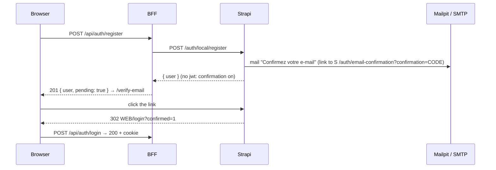

# 05 — Account: password reset, email confirmation, account page, Google profile

Branch: `feature/account` · Target: `development` · Estimate: 15 h · Status: done (2026-10-27)

## 1. Goal

After this branch, authentication is complete. A reader who forgot their password gets a reset link by email. A new sign-up must confirm the email before logging in. Every reader has an account page to change their display name, username and password, or delete the account. Google sign-in brings the reader's name and picture, and a Google login on an email that already has a password logs that account in instead of failing. The project ships a mailer that works in development (Mailpit, every mail visible in a browser) and in production (any SMTP, Resend or Brevo).

Brief lines served: "full authentication optional" (we deliver the full thing), "every discussion/reply linked to a user" (display name and avatar now appear on posts). Tracker items 21 to 25.

## 2. Scope

**In**

- Phase 0, static shell and islands (user request, 2026-10-27): every page renders its static parts instantly; each data section is an island (`Suspense` + error boundary) with its own skeleton, its own translated error message and its own retry. A failing list, nav, space card or account menu never takes the page down. Reusable `Island` component, `useApiErrorMessage` hook mapping BFF codes to fr/en text.
- Mailer: Strapi email plugin with the nodemailer provider; Mailpit service in `docker-compose.yml` (SMTP 1025, UI http://localhost:8025); SMTP env variables; without `SMTP_HOST` mails are discarded with a boot warning (zero-setup mode keeps working).
- Strapi settings set at boot (`ensure-email.ts`): reset URL `${WEB_URL}/reset-password`, confirmation on, confirmation landing `${WEB_URL}/login?confirmed=1`, branded French templates with an English line, sender from env.
- Forgot / reset password: `/forgot-password` (email → always "if an account exists, a mail was sent"), `/reset-password?code=` (new password twice → logged in).
- Email confirmation: sign-up answers "check your inbox" (`/verify-email`), resend button, login refused with a clear message until confirmed, `?confirmed=1` banner on the login page. Demo and Google accounts are confirmed.
- User fields `displayName` (optional, 2–60) and `avatarUrl` (optional URL) on the Users & Permissions user, through the plugin extension.
- Google: `profile` scope, profile fetched from Google's userinfo, name and picture stored at first login; a Google login on an email that already has a password logs that account in (Google verifies the email) and fills name and picture if empty.
- Account page `/account` (protected): profile card (avatar, display name, username, email, "via Google" badge), edit display name and username, change password (hidden for Google-only accounts), delete account with confirmation by typing the username.
- Strapi: `is-self` policy on `user.update` and `user.destroy` (own id only, allowed fields only), granted to Authenticated.
- Posts show display name and avatar: presenter and list/detail populate expose `displayName` and `avatarUrl` next to `username`; cards fall back to initials.
- BFF handlers: `POST /api/auth/forgot-password`, `POST /api/auth/reset-password`, `POST /api/auth/send-confirmation`, `POST /api/auth/change-password`, `PATCH /api/account`, `DELETE /api/account`.
- Tests: cms integration (confirmation flow, reset flow, is-self policy, presenter fields), web unit (handlers, forms), Playwright end to end through Mailpit's API (sign-up → mail → confirm → login; forgot → mail → reset).
- ADR-0010 (mailer, confirmation, Google linking), README in both languages, tracker.

**Out**

- Avatar upload (Strapi upload plugin, storage): evolution; Google picture or initials for now.
- Changing the email address (needs re-confirmation flow): evolution.
- Two-factor, passkeys, refresh tokens: evolutions; token lifetime decision stays open (tracker 32).
- Rate limiting of `forgot-password` beyond Strapi's defaults: noted as a risk.

## 3. Acceptance criteria

0. `/discussions`: the title, intro, filter chrome and layout render without waiting for any data; with `/api/discussions` answering 503, the title, nav and space card still show and only the list shows "Le serveur de contenu est indisponible" with a Réessayer button that refetches the list alone; the same for a failing category read (nav hidden, page intact) and a failing account read (sign-in buttons shown). No raw server message ever appears.
1. `POST /api/auth/forgot-password` with a known email → a mail in Mailpit with a link to `/reset-password?code=…`; with an unknown email → same 200 answer, no mail; the page says the same sentence in both cases.
2. `/reset-password?code=<valid>` with a new password (≥ 8, confirmed) → logged in, redirected to `/discussions`, the old password no longer works, the link cannot be reused; an invalid or used code shows "Lien expiré ou invalide" with a link to ask for a new one.
3. Sign-up → 201 `{ pending: true }`, no cookie, `/verify-email` page; a mail with the confirmation link arrives; before clicking, login answers 403 `EMAIL_NOT_CONFIRMED` and the form shows it with a "resend" action; after clicking, the browser lands on `/login?confirmed=1` with a green banner and login works.
4. Resend: `POST /api/auth/send-confirmation { email }` → a new mail; always 200.
5. Google first login stores `displayName` and `avatarUrl`; the header shows the picture and the name; posts by that reader show them too.
6. Google login with an email that already has a password → logged into that account (no "already taken"), name and picture filled if they were empty, password still works afterwards.
7. `/account` logged out → redirect to `/login?next=/account`. Logged in: display name and username editable (same rules as sign-up, 409 on a taken username), change password needs the current one and logs the new one in immediately (cookie rotated), Google-only accounts see no password section.
8. Delete: typing the username enables the button; after deletion the cookie is cleared, the user is gone from Strapi, their discussions remain with "Compte supprimé" as author.
9. `is-self`: a reader cannot `PUT` or `DELETE` another user, nor change `email`, `role`, `confirmed`, `blocked`, `provider` on their own record (403 or field ignored); proven by integration tests.
10. Without `SMTP_HOST` (zero-setup mode) nothing crashes: forgot-password still answers 200, Strapi logs one warning at boot.
11. Every new page: fr and en, three widths, loading skeleton, keyboard, errors announced.
12. Unit, integration and e2e of section 7 green; `pnpm verify` green.

## 4. Mockups

- `docs/mockups/05-account/forgot-reset.html` — forgot form, "mail sent" state, reset form, invalid link state.
- `docs/mockups/05-account/verify-email.html` — after sign-up, resend, login page with the confirmed banner and the "not confirmed" error.
- `docs/mockups/05-account/account.html` — account page with the Google header, profile edit, password change, danger zone, deletion dialog; mobile frame.

```
/account
┌────────────────────────────────────────────────────────────┐
│ (photo) Claire Nantes            via Google                 │
│ @claire.nantes · claire@gmail.com                           │
├────────────────────────────────────────────────────────────┤
│ PROFIL      Nom affiché [Claire Nantes]  Nom d'utilisateur  │
│             [claire.nantes]              [Enregistrer]      │
├────────────────────────────────────────────────────────────┤
│ MOT DE PASSE  (masqué pour un compte Google sans mot de passe)
│             Actuel [••••] Nouveau [••••] Confirmer [••••]   │
├────────────────────────────────────────────────────────────┤
│ ZONE ROUGE  Supprimer mon compte  → dialog: tapez votre nom │
└────────────────────────────────────────────────────────────┘
```

### Backend contract

| Method · path (BFF)                | Auth   | Body                                                  | Answers                                                           |
| ---------------------------------- | ------ | ----------------------------------------------------- | ----------------------------------------------------------------- |
| `POST /api/auth/forgot-password`   | —      | `{ email }`                                           | 200 `{ ok: true }` always                                         |
| `POST /api/auth/reset-password`    | —      | `{ code, password, passwordConfirmation }`            | 200 `{ user }` + cookie · 400 `INVALID_CODE` · 422                |
| `POST /api/auth/send-confirmation` | —      | `{ email }`                                           | 200 `{ ok: true }` always                                         |
| `POST /api/auth/register`          | —      | unchanged                                             | 201 `{ user, pending: true }`, no cookie                          |
| `POST /api/auth/login`             | —      | unchanged                                             | + 403 `EMAIL_NOT_CONFIRMED`                                       |
| `POST /api/auth/change-password`   | cookie | `{ currentPassword, password, passwordConfirmation }` | 200 `{ user }` + rotated cookie · 401 `INVALID_CREDENTIALS` · 422 |
| `PATCH /api/account`               | cookie | `{ displayName?, username? }`                         | 200 `{ user }` · 409 `ALREADY_TAKEN` · 422                        |
| `DELETE /api/account`              | cookie | `{ username }` (confirmation)                         | 204, cookie cleared · 422                                         |
| `GET /api/auth/me`                 | cookie | —                                                     | `user` gains `displayName`, `avatarUrl`, `provider`               |

Strapi side (existing endpoints, called by the BFF with the JWT): `/auth/forgot-password`, `/auth/reset-password`, `/auth/send-email-confirmation`, `/auth/change-password`, `PUT /users/:id`, `DELETE /users/:id`. `GET /auth/email-confirmation?confirmation=` is hit by the mail link directly and redirects to the web app.

### Confirmation sequence



## 5. Design

### Files

```
docker-compose.yml                         + mailpit service (axllent/mailpit, ports 1025 and 8025), profile default
apps/cms/
  config/plugins.ts                        email: nodemailer provider from SMTP_* (jsonTransport when SMTP_HOST is empty), defaultFrom, defaultReplyTo
  src/bootstrap/ensure-email.ts            advanced settings (reset URL, confirmation on, landing), templates, boot warning without SMTP
  src/bootstrap/ensure-providers.ts        + scope ['email', 'profile']
  src/bootstrap/ensure-google-profile.ts   registry.add('google', …) with userinfo → { username, email, displayName, avatarUrl }
  src/extensions/users-permissions/
    content-types/user/schema.json         base schema + displayName, avatarUrl
    strapi-server.ts                       is-self policy on user.update / user.destroy, allowed-fields filter, providers.connect override (linking)
  src/api/discussion/utils/presenter.ts    AUTHOR_POPULATE fields: username, displayName, avatarUrl; PublicAuthor gains them
  src/bootstrap/ensure-permissions.ts      Authenticated + user.update, user.destroy
  tests/                                   confirmation.test.ts, password-reset.test.ts, account.test.ts (is-self), author fields in list test
  .env.example / .env.ci / .env.sqlite     SMTP_HOST, SMTP_PORT, SMTP_USER, SMTP_PASS, SMTP_SECURE, EMAIL_FROM, EMAIL_REPLY_TO

apps/web/src/
  features/auth/schemas.ts                 forgotSchema, resetSchema, changePasswordSchema, accountSchema; sessionUser + displayName, avatarUrl, provider
  features/auth/api/mutations.ts           useForgotPassword, useResetPassword, useSendConfirmation, useChangePassword, useUpdateAccount, useDeleteAccount
  features/auth/components/                forgot-form, reset-form, verify-email, account-profile-form, change-password-form, delete-account-dialog, user-avatar
  app/api/auth/{forgot-password,reset-password,send-confirmation,change-password}/route.ts
  app/api/account/route.ts                 PATCH, DELETE
  app/[locale]/(auth)/forgot-password  reset-password  verify-email   pages
  app/[locale]/(forum)/account/page.tsx    protected, under the forum shell
  components/layout/user-menu.tsx          avatar image, display name, "Mon compte" entry
  features/discussions/components/discussion-card.tsx   author display name + avatar, initials fallback
  next.config.ts                           images.remotePatterns: lh3.googleusercontent.com
  messages/fr.json, en.json                Auth.*, Account.*, Form.*
  e2e/account.spec.ts                      sign-up → Mailpit API → confirm → login; forgot → Mailpit → reset
```

### Mailer

| Env                      | Dev (docker)                                    | Zero-setup                           | Prod                 |
| ------------------------ | ----------------------------------------------- | ------------------------------------ | -------------------- |
| `SMTP_HOST`              | `localhost` (Mailpit)                           | empty → mails discarded, one warning | provider host        |
| `SMTP_PORT`              | 1025                                            | —                                    | 587 / 465            |
| `SMTP_USER`, `SMTP_PASS` | empty                                           | —                                    | provider credentials |
| `EMAIL_FROM`             | `Communauté Le Revenu <no-reply@lerevenu.test>` | same                                 | real sender          |

Templates (store `email`): subject "Réinitialisez votre mot de passe" / "Confirmez votre adresse e-mail", short body in French with the link, one English line, no HTML layout beyond a paragraph (deliverability, simplicity).

### Linking (providers.connect override)

Strapi's `connect` throws "Email is already taken" when the email exists with another provider. The override: if Google (email verified) and a user with that email exists → return that user, filling `displayName` and `avatarUrl` when empty. No change to `provider`, so the password keeps working. Everything else delegates to the original function.

### is-self policy

Applies to `PUT /users/:id` and `DELETE /users/:id`: `params.id` must equal `state.user.id`; on update the body is reduced to `username` and `displayName` (anything else is dropped). The BFF only ever sends those two, the policy protects against direct callers.

### Forms

Same hook and field components as branch 04. Password confirmation checked client-side (zod `refine`) and by Strapi. Account page is a Server Component shell with three client forms, each owning its mutation and messages.

## 6. Phases and steps

### Phase 0 — Static shell and islands (3 h)

0. `components/shared/island.tsx` (Suspense + `react-error-boundary` + TanStack `QueryErrorResetBoundary`), `hooks/use-api-error-message.ts`, island skeletons and error fallbacks.
1. `/discussions` page: no data awaited at page level; category nav, chips, list, space card and header account menu become islands; `loading.tsx` and `error.tsx` stay as outer nets.
2. Tests: `island.test.tsx` (error → fallback → retry), Playwright `resilience.spec.ts` (503 on the list, page intact, retry recovers).
   Exit: criterion 0; first paint of `/discussions` carries title and filters before the list streams.

### Phase A — Mailer and Strapi settings (2 h)

1. Mailpit in compose, nodemailer provider, `config/plugins.ts`, env files.
2. `ensure-email.ts`: settings, templates, warning without SMTP.
3. curl `POST /auth/forgot-password` → mail visible at http://localhost:8025.
   Exit: criteria 1 (mail side), 10.

### Phase B — User fields, Google profile, linking, presenter (2.5 h)

4. Extension schema, `ensure-google-profile.ts`, scope, `strapi-server.ts` with the connect override and the is-self policy, permissions.
5. Presenter and populate expose `displayName`, `avatarUrl`; seed gives a few demo readers a display name.
6. Integration tests: is-self, presenter fields, confirmation flow (register → unconfirmed → confirm by token → login), reset flow (token from the database in tests).
   Exit: criteria 5 (Strapi side), 6, 9; 41 + new tests green.

### Phase C — BFF (2.5 h)

7. Schemas, six handlers, auth error mapping (`EMAIL_NOT_CONFIRMED`, `INVALID_CODE`), register and login changes, `me` fields.
8. Unit tests of each handler.
   Exit: curl pass on every handler; criteria 2, 3, 4, 7, 8 (API side).

### Phase D — Pages (3.5 h)

9. Forgot, reset, verify-email pages and forms; login banner and "not confirmed" message; register redirect to verify-email.
10. Account page: profile form, password form, delete dialog; header avatar and "Mon compte"; discussion card with display name and avatar; `next.config.ts` images.
11. Messages fr/en, unit tests of the forms.
    Exit: criteria 2, 3, 5, 7, 8, 11 by hand.

### Phase E — E2E, docs, delivery (1.5 h)

12. `e2e/account.spec.ts` through Mailpit's API; `expect.timeout` raised for dev; auth spec stabilised against a built app in CI (tracker 29 if time allows).
13. ADR-0010, README fr + en (mailer setup, Mailpit, account), plan done, tracker 21–25 green, `pnpm verify`, push, PR text.

## 7. Tests

| Kind            | File                                                                                                                                   | Covers    |
| --------------- | -------------------------------------------------------------------------------------------------------------------------------------- | --------- |
| web unit        | `components/shared/island.test.tsx` — renders children, shows the fallback on a thrown ApiError with the translated text, retry resets | 0         |
| e2e             | `e2e/resilience.spec.ts` — `/api/discussions` forced to 503: title, nav, space card visible, list error with retry, retry recovers     | 0         |
| cms integration | `tests/confirmation.test.ts` — register → no jwt, login 400, confirm with the token read from the DB, login 200                        | 3         |
| cms integration | `tests/password-reset.test.ts` — forgot sets a token, reset with it logs in, reuse refused, unknown email 200                          | 1, 2      |
| cms integration | `tests/account.test.ts` — is-self: update other 403, delete other 403, forbidden fields dropped, delete self 200 and discussions kept  | 8, 9      |
| cms integration | `discussions.list.test.ts` (update) — author keys `documentId, username, displayName, avatarUrl`                                       | 5         |
| web unit        | `app/api/auth/*/route.test.ts` for the four new handlers + `app/api/account/route.test.ts`                                             | 1–4, 7, 8 |
| web unit        | `features/auth/schemas.test.ts` (update) — reset confirmation mismatch, account rules                                                  | 2, 7      |
| web unit        | `forgot-form`, `reset-form`, `change-password-form`, `delete-account-dialog` tests                                                     | 2, 7, 8   |
| e2e             | `e2e/account.spec.ts` — sign-up → confirm via Mailpit → login; forgot → reset via Mailpit → logged in                                  | 1–4       |

## 8. Manual verification

- [ ] Mailpit UI shows both mails with working links, in fr and en pages
- [ ] Zero-setup mode: forgot-password answers, no crash, one warning in the log
- [ ] Google first login: name and picture in the header and on a post; second login: same account
- [ ] Google on alice's email after setting a password: logs into alice
- [ ] Account page at 400 / 760 / 1180, dark, keyboard; delete flow end to end
- [ ] Deleted reader's discussion shows "Compte supprimé"

## 9. Risks and open questions

| Risk or question                                                | Mitigation or decision                                                                                                   |
| --------------------------------------------------------------- | ------------------------------------------------------------------------------------------------------------------------ |
| Strapi `forgot-password` on a Google-only account (no password) | Strapi still sends the mail; reset sets a password, which also "links" the account the other way. Acceptable, documented |
| No rate limit on forgot / resend                                | Strapi's limiter covers login only; a BFF per-IP throttle is an evolution; Mailpit absorbs dev traffic                   |
| Extension `strapi-server.ts` typing                             | Strapi 5 extension API is loosely typed; keep the file small, typed locally, covered by integration tests                |
| `providers.connect` override drifts with Strapi updates         | Override delegates to the original for everything but the "already taken" branch; integration test pins the behaviour    |
| Google picture URL expires or changes                           | Stored as a URL, refreshed at each Google login; initials fallback when the image fails                                  |
| Mailpit missing on a reviewer's machine                         | Zero-setup mode discards mails and says so; the README explains the Docker path for the full flow                        |

## 10. Definition of done

- [ ] All acceptance criteria met
- [ ] Tests in section 7 green locally and in CI
- [ ] Manual checklist done
- [ ] Docs updated (ADR-0010, README fr + en, this plan's status, plans index, tracker)
- [ ] PR opened against `development` with screenshots
